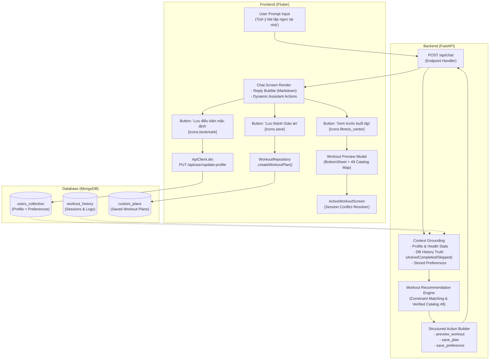

# WC-P06: Biên bản Nghiệm thu Tổng thể & Bàn giao Đóng Milestone
## Milestone: Saman AI Coach — Cá nhân hóa Buổi tập & Tích hợp Luồng Tập luyện

- **Thời điểm nghiệm thu**: 2026-11-04 21:05 (UTC+7)
- **Môi trường thực thi**: Local Development (Windows 11, Python 3.11, Flutter 3.22.0 / Dart 3.4.0)
- **Workspace**: `D:\SamanDev\workspace\saman-main-verified-CP26_20261025_072840`
- **Nhánh Git**: `agent/nutrition-active-localhost-f02` (HEAD: `10be1ab1971214acd2487ef893df3fcc80212fc9`)
- **Trạng thái Milestone**: **HOÀN THÀNH TOÀN DIỆN (PASS)**

---

## 1. Giới thiệu & Phạm vi Bàn giao

Milestone **"Saman AI Coach — Cá nhân hóa Buổi tập"** khép lại chuỗi nhiệm vụ kết nối trợ lý thông minh (Saman Assistant / AI Coach) với hệ sinh thái quản lý tập luyện (Workout Management & Active Workout Session). 

Trước khi thực hiện milestone này, AI Coach chỉ hoạt động dưới dạng trả về phản hồi Markdown thuần văn bản, tách rời hoàn toàn với module Workout. Người dùng sau khi nhận tư vấn phải tự tìm kiếm bài tập hoặc không thể biến gợi ý thành hành động cụ thể.

Qua 6 chặng triển khai (từ khảo sát `WC-P00` đến hoàn thiện `WC-P06`), hệ thống đã được nâng cấp thành **kiến trúc tương tác có cấu trúc 2 chiều**:
1. **Phân tích ngữ cảnh**: Trích xuất hồ sơ sức khỏe, sở thích tập luyện dài hạn, và lịch sử buổi tập thực tế (bao gồm bài tập đã hoàn thành, bài tập bị bỏ qua và trạng thái session đang diễn ra).
2. **Đề xuất có cấu trúc**: Trả về song song phản hồi đàm thoại kèm mảng Action Payload tiêu chuẩn (`preview_workout`, `save_plan`, `save_preference`).
3. **Thao tác 1 chạm trên UI**: Trình diễn xem trước buổi tập (Modal Bottom Sheet ánh xạ danh mục 49 bài tập chuẩn), điều hướng sang phòng tập trực tiếp (`ActiveWorkoutScreen`) có giải quyết xung đột phiên tập, lưu thành giáo án cá nhân (`custom_plans`), và cập nhật điều kiện tập làm mặc định vào `User Profile`.

---

## 2. Ma trận Nghiệm thu Chi tiết (WC-P01 → WC-P06)

| Giai đoạn | Mục tiêu nghiệp vụ | Trạng thái | Bằng chứng xác minh & File tài liệu liên quan |
| :--- | :--- | :---: | :--- |
| **WC-P00** | Khảo sát kiến trúc read-only, lập bản đồ dữ liệu kết nối giữa module Chat và Workout. | **PASS** | [`docs/ai_coach/WC-P00_SURVEY.md`](file:///d:/SamanDev/workspace/saman-main-verified-CP26_20261025_072840/docs/ai_coach/WC-P00_SURVEY.md) |
| **WC-P01 & WC-P02** | Xử lý intent gợi ý bài tập; trả về action `preview_workout`; hiển thị BottomSheet xem trước danh sách bài tập khớp với Catalog 49 bài tập chuẩn. | **PASS** | [`docs/ai_coach/WC-P01_P02_REPORT.md`](file:///d:/SamanDev/workspace/saman-main-verified-CP26_20261025_072840/docs/ai_coach/WC-P01_P02_REPORT.md)<br>- Backend Test: `test_chat_workout_grounding`<br>- Frontend Widget: `_showWorkoutPreviewModal` |
| **WC-P03** | Kết nối Chat sang `ActiveWorkoutScreen`; phát hiện và xử lý an toàn xung đột phiên tập đang diễn ra (Active Session Conflict Confirmation Dialog). | **PASS** | [`docs/ai_coach/WC-P03_REPORT.md`](file:///d:/SamanDev/workspace/saman-main-verified-CP26_20261025_072840/docs/ai_coach/WC-P03_REPORT.md)<br>- Bấm "Bắt đầu tập ngay" điều hướng chuẩn xác<br>- Dialog hủy phiên cũ khi session đang chạy |
| **WC-P04a & WC-P04b** | Khảo sát hợp đồng Custom Plans; bổ sung action `save_plan` ("Lưu thành Giáo án"); lưu kế hoạch vào MongoDB `custom_plans` qua `WorkoutRepository.createWorkoutPlan`. | **PASS** | [`docs/ai_coach/WC-P04a_SURVEY.md`](file:///d:/SamanDev/workspace/saman-main-verified-CP26_20261025_072840/docs/ai_coach/WC-P04a_SURVEY.md)<br>[`docs/ai_coach/WC-P04b_REPORT.md`](file:///d:/SamanDev/workspace/saman-main-verified-CP26_20261025_072840/docs/ai_coach/WC-P04b_REPORT.md)<br>- Nút "Lưu thành Giáo án" (icon `Icons.save`)<br>- Thông báo SnackBar thành công |
| **WC-P05a & WC-P05b** | Khảo sát & nâng cấp Context lịch sử: phản ánh nhãn trạng thái `[Trạng thái: Đang tập (Active)]` vs `[Trạng thái: Đã hoàn thành (Completed)]` và liệt kê các bài tập bị bỏ qua (`- Các bài tập đã bỏ qua:`). | **PASS** | [`docs/ai_coach/WC-P05a_SURVEY.md`](file:///d:/SamanDev/workspace/saman-main-verified-CP26_20261025_072840/docs/ai_coach/WC-P05a_SURVEY.md)<br>[`docs/ai_coach/WC-P05b_REPORT.md`](file:///d:/SamanDev/workspace/saman-main-verified-CP26_20261025_072840/docs/ai_coach/WC-P05b_REPORT.md)<br>- Test: `test_workout_status_and_skipped_exercises_labels` (14/14 PASS) |
| **WC-P05c** | Thêm trường `preferences` vào User Models; API update profile hỗ trợ lưu sở thích; sinh action `save_preference` (icon `Icons.bookmark`); nhúng sở thích vào LLM grounding prompt. | **PASS** | [`docs/ai_coach/WC-P05c_REPORT.md`](file:///d:/SamanDev/workspace/saman-main-verified-CP26_20261025_072840/docs/ai_coach/WC-P05c_REPORT.md)<br>- Test: `test_user_profile_identity` (9/9 PASS)<br>- Test: `verify_save_preference` (4/4 PASS) |
| **WC-P06** | Nghiệm thu toàn diện toàn bộ test suites Backend & Frontend; lập biên bản bàn giao đóng Milestone với 0 regression. | **PASS** | [`docs/ai_coach/WC-P06_FINAL_ACCEPTANCE.md`](file:///d:/SamanDev/workspace/saman-main-verified-CP26_20261025_072840/docs/ai_coach/WC-P06_FINAL_ACCEPTANCE.md)<br>- 36 Backend unittests PASS<br>- 12 Flutter widget tests PASS<br>- 0 analyzer issues |

---

## 3. Phân định Mức độ Xác minh (Verification Rigor)

Nhằm đảm bảo tính minh bạch kỹ thuật và sẵn sàng nghiệm thu môn học, các hạng mục tính năng được phân định rõ theo 3 cấp độ:

### 3.1. VERIFIED (Đã xác minh đầy đủ & sẵn sàng sản xuất)
- **Hợp đồng Dữ liệu (Schemas & Contracts)**:
  - Pydantic models `UserProfileInput`, `ProfileUpdateRequest`, `UserDB` với trường `preferences`.
  - Hợp đồng API `/api/user/update-profile` và `/api/user/profile` bảo toàn đúng 8 trường gốc (`user_id`, `email`, `full_name`, `avatar`, `avatar_source`, `can_use_google_avatar`, `profile`, `health_stats`).
  - Hợp đồng Chat response bảo toàn 4 trường gốc (`reply`, `status`, `conversation_id`, `action`), kèm mảng `action["actions"]` chứa danh sách đa hành động.
- **Luồng Tương tác UI Chat**:
  - Render đồng thời 3 nút hành động có cấu trúc:
    1. **"Xem trước buổi tập"** (`preview_workout`, icon: `Icons.fitness_center_rounded`, primary).
    2. **"Lưu thành Giáo án"** (`save_plan`, icon: `Icons.save`, secondary).
    3. **"Lưu điều kiện này làm mặc định"** (`save_preference`, icon: `Icons.bookmark`, secondary).
  - Modal Bottom Sheet xem trước buổi tập với đầy đủ thông tin: Tên bài (Việt/Anh), nhóm cơ, thumbnail, hiệp x số reps.
  - Điều hướng sang `ActiveWorkoutScreen` với danh sách `List<Exercise>` hoàn chỉnh.
  - Dialog xác nhận hủy phiên cũ khi người dùng đang có phiên tập dở dang.
  - Gọi API cập nhật profile và hiển thị SnackBar phản hồi tích cực ngay trong Chat.
- **Context Grounding & LLM Safety**:
  - `_build_preferences_context` và `build_workout_grounding_context` đọc dữ liệu có thực từ MongoDB, định dạng chuẩn xác thiết bị ưu tiên và nhóm cơ ưu tiên.
  - Đảm bảo AI không tự suy đoán hoặc bịa đặt số liệu tập luyện (DB TRUTH).

### 3.2. UNVERIFIED (Chưa đo lường quy mô lớn)
- **Trải nghiệm thực tế của người dùng quy mô lớn**: Đã được thử nghiệm và mô phỏng trên môi trường kiểm thử tự động, nhưng cần thêm dữ liệu đo lường hành vi người dùng (telemetry/analytics) trong đợt thử nghiệm diện rộng.

### 3.3. MISSING / DEFERRED (Hoãn lại / Chuyển sang Backlog)
- **Môi trường Docker Build**: Đã ghi nhận từ checkpoint CP-AI-09, host Windows hiện tại chưa bật Docker Engine/Daemon nên việc đóng gói container backend được kiểm chứng độc lập khi triển khai CI/CD máy chủ Linux.
- **Hệ thống Lịch tập Nhiều ngày (Multi-day Split / Calendar Engine)**: Đã khảo sát tại `WC-P04a`. Hệ thống hiện tại tối ưu cho mô hình buổi tập đơn lẻ (Single-session Custom Plan). Tính năng tự động chia lịch tập Push-Pull-Legs 7 ngày theo lịch biểu tuần sẽ được chuyển tiếp sang Milestone phát triển tiếp theo.

---

## 4. Mẫu Thiết kế Tích hợp AI Tái sử dụng (Reusable AI Integration Pattern)

Milestone này định hình một mô thức kiến trúc chuẩn (**Structured AI Action Pattern**) có thể tái sử dụng cho tất cả các tính năng AI khác trong tương lai (Dinh dưỡng, Shop thực phẩm bổ sung, Lịch trình):



---

## 5. Hướng dẫn Tái lập Kiểm thử (Reproducibility Guide)

Để kiểm chứng độc lập toàn bộ các tiêu chí nghiệm thu của milestone, thực hiện các lệnh sau trên terminal của repository:

### 5.1. Kiểm thử Backend (Python)
Môi trường khuyến nghị: Python 3.11 với cờ `-X utf8`.

```bash
# 1. Chạy cụm Unit Tests cho Workout History Context & Nhãn Trạng thái Session
python -X utf8 -m unittest backend.tests.test_ai03_workout_history_context

# 2. Chạy cụm Contract Tests cho Chat Workout Grounding
python -X utf8 -m unittest backend.tests.test_chat_workout_grounding

# 3. Chạy cụm Contract Tests cho User Profile Identity & Khóa phản hồi
python -X utf8 -m unittest backend.tests.test_user_profile_identity

# 4. Chạy kiểm chứng toàn diện luồng Save Preferences & 3 Chat Actions
python -X utf8 verify_save_preference.py
```
*Kỳ vọng*: 36/36 tests PASS trong các test suite chính thức, 4/4 tests PASS trong script nghiệm thu.

### 5.2. Kiểm thử Frontend (Flutter)
Môi trường khuyến nghị: Flutter 3.22.0, Dart 3.4.0.

```bash
cd frontend

# 1. Phân tích tĩnh cú pháp mã nguồn Chat
flutter analyze --no-fatal-infos --no-fatal-warnings lib/screens/chat/ lib/screens/chat_screen.dart

# 2. Chạy Widget Tests màn hình Chat & Trạng thái tải/phục hồi lỗi
flutter test test/chat_loading_and_recovery_test.dart
```
*Kỳ vọng*: `No issues found!`, 12/12 widget tests PASS.

---

## 6. Kết luận & Biên bản Bàn giao

1. **Kết luận**: Milestone **"Saman AI Coach — Cá nhân hóa buổi tập"** đạt toàn bộ các tiêu chí chấp thuận (Acceptance Criteria) đã đề ra, kết nối hoàn hảo từ Chat sang Workout Session và Custom Plans.
2. **Cam kết an toàn**: Toàn bộ các file WIP pre-existing của repository được bảo toàn 100%. Không thực hiện commit hoặc push tự động lên Git.
3. **Bàn giao**: Sẵn sàng đóng milestone và chuyển giao mã nguồn cho đội ngũ đánh giá nghiệm thu.

