# BÁO CÁO NGHIỆM THU TƯƠNG TÁC THỰC TẾ JCOM-04A
## INTERACTIVE FRONTEND ACCEPTANCE & CAPABILITY AUDIT

**Dự án:** Saman App — Phân hệ Journal & Community  
**Checkpoint:** JCOM-04A (Interactive Frontend Acceptance & Capability Audit)  
**Thời gian thực thi:** 01/11/2026 22:45:00 +07:00  
**Kỹ sư thực thi:** Senior Flutter Engineer  
**Môi trường thử nghiệm:** Google Chrome 156.0 (Headless CDP) kết nối Web Runtime `http://127.0.0.1:8089/`  

---

## 1. Mục Tiêu & Kết Luận Phân Định Bốn Khía Cạnh

Thực hiện nghiêm túc chỉ thị kiểm chứng thực tế và minh bạch kỹ thuật của dự án, nhóm kỹ sư đã khép lại chuỗi kiểm thử tương tác runtime cho toàn bộ 18 màn hình Journal & Community (`R01`–`R15`) trên tiến trình trình duyệt web thật.

Kết luận kỹ thuật được phân định rạch ròi thành **bốn khía cạnh độc lập**:

```mermaid
flowchart TD
    subgraph S1["1. Frontend Preview Runtime"]
        F1["18 Screens R01-R15 + Bottom Nav + Composer + Drafts"] -->|"CDP Chrome Automation (18 Screenshots)"| R1["PASS (100% Verified)"]
    end
    subgraph S2["2. Tích hợp từ Home qua Auth/Profile"]
        F2["MainScreen -> ProfileRemoteDataSourceImpl"] -->|"GET /api/user/profile thiếu user_id"| R2["BLOCKED (Backend Profile Defect)"]
    end
    subgraph S3["3. Backend Journal & Community"]
        F3["FastAPI Routers & MongoDB Collections"] -->|"Strict Freeze theo AGENTS.md"| R3["NOT IMPLEMENTED (Handoff Delivered)"]
    end
    subgraph S4["4. Media Processing & Attachments"]
        F4["Crop, Rotate, Filters & Workout/Meal Snapshots"] -->|"Visual Controls & sanitize() Fixtures"| R4["PREVIEW ONLY (Truthful Disclosure)"]
    end
```



1. **Frontend Preview Runtime:** **PASS (Đạt)**
   - 100% 18 màn hình giao diện, thanh điều hướng 5 tabs, luồng soạn thảo 4 bước, kho bản nháp, thông báo, bài viết đã lưu và chi tiết Q&A đều hoạt động trơn tru, không có lỗi runtime hay tràn viền (0 RenderFlex overflow).
2. **Tích hợp từ Home qua Auth / Profile:** **BLOCKED (Bị chặn)**
   - Không tự ý công nhận PASS cho luồng traversal từ Home. Endpoint `/api/user/profile` của backend trả về thiếu trường bắt buộc `user_id`, khiến `ProfileRemoteDataSourceImpl` ném `FormatException`.
3. **Backend Journal / Community:** **NOT IMPLEMENTED (Đóng băng)**
   - Tuyệt đối không can thiệp code trong `backend/`. Toàn bộ đặc tả kiến trúc, endpoints và lược đồ dữ liệu đã được bàn giao tại `docs/jcom05_backend_handoff/JCOM05_HANDOFF.md`.
4. **Media Processing & Attachment Source:** **PREVIEW CONTROLS & REPOSITORY FIXTURES**
   - Media editing hoạt động bằng bộ điều khiển giao diện Flutter (`Transform.rotate`, `ColorFiltered.matrix`), không rasterize xuất file ảnh mới. Dữ liệu đính kèm hoạt động lấy từ fixtures mô phỏng của repository và đã được triệt tiêu hoàn toàn các trường nhạy cảm bằng hàm `sanitize()`.

---

## 2. Thông Số Môi Trường Thử Nghiệm & Lệnh Khởi Chạy

Để phục vụ nghiệm thu tương tác độc lập theo đúng quy định cho phép khi app chính bị Profile chặn:
- **Entrypoint Preview riêng:** `frontend/lib/features/community/main_community_preview.dart` (Nằm trong `allowed_paths`).
  - Kế thừa 100% screens, widgets, theme và models của ứng dụng.
  - Sử dụng Fake Repository in-memory qua Riverpod DI.
  - Sử dụng danh tính mẫu tổng hợp ("Linh Nguyễn - Bản xem trước").
  - Gắn banner cảnh báo `[PREVIEW]` cố định trên toàn bộ giao diện.
- **Lệnh build web preview:**
  ```bash
  cd frontend
  flutter build web -t lib/features/community/main_community_preview.dart --output build/preview_web --no-tree-shake-icons --no-pub -O1
  ```
- **Web Server Runtime:**
  - Lệnh: `python -m http.server 8089 --directory frontend/build/preview_web`
  - Cổng: `8089` (IPv4 `127.0.0.1:8089`).
- **Browser Automation Daemon:**
  - Lệnh: `chrome.exe --headless=new --remote-debugging-port=9222 --user-data-dir=... http://127.0.0.1:8089/`
  - Cổng CDP: `9222`.
  - Phiên bản: `Google Chrome 156.0.8078.74`.
  - Script điều khiển tự động: `scratch/run_cdp.js` và `scratch/run_cdp_interactive.js` (Node.js v24.19.0).

---

## 3. Danh Mục 18 Ảnh Chụp Runtime Thực Tế Qua CDP

Toàn bộ ảnh chụp màn hình được kết xuất trực tiếp từ trình duyệt Chrome tại `docs/jcom04a_interactive_acceptance/screenshots/`:

| Tên tệp ảnh | Kích thước | Độ phân giải | Nội dung xác minh runtime |
| :--- | :---: | :---: | :--- |
| `rt01_journal_discover.png` | 615 KB | 393 x 852 (2.0x) | R01 Journal Discover: Banner preview, Hero card, Chips, Bài viết, Lối vào Community |
| `rt02_journal_search.png` | 299 KB | 393 x 852 (2.0x) | R02 Journal Search: Thanh tìm kiếm debounce, bộ lọc 4 danh mục kết quả |
| `rt03_community_feed.png` | 133 KB | 393 x 852 (2.0x) | R03 Community Feed: 3 tabs phân loại, thẻ Meal/Workout/QA, thanh điều hướng 5 nút |
| `rt04_community_discover.png` | 130 KB | 393 x 852 (2.0x) | R04 Community Discover: Lưới ảnh 3 cột visual grid, chủ đề thịnh hành, gợi ý creator |
| `rt05_post_detail.png` | 144 KB | 393 x 852 (2.0x) | R05 Post Detail: Chi tiết bài viết, đính kèm, bình luận lồng nhau, composer ở đáy |
| `rt06_unknown_post_state.png` | 21 KB | 393 x 852 (2.0x) | Xử lý ID bài viết không tồn tại: Màn hình Empty State trực quan kèm nút thử lại |
| `rt07_composer_select_media.png` | 1.29 MB | 393 x 852 (2.0x) | R06A Select Media: Khung xem trước lớn, lưới chọn ảnh, nút đăng text-only |
| `rt08_composer_select_attachment.png` | 216 KB | 393 x 852 (2.0x) | R07 Activity Attachment: Tab Buổi tập/Bữa ăn, công tắc bảo mật TẮT tạ & calo |
| `rt09_composer_ask_question.png` | 92 KB | 393 x 852 (2.0x) | R08 Ask Question: Đặt câu hỏi Q&A trực tiếp, đếm 150 ký tự, bắt buộc chọn chủ đề |
| `rt10_composer_publish_screen.png` | 70 KB | 393 x 852 (2.0x) | R06D Compose & Publish: Caption, chọn quyền riêng tư, hashtag, khóa double-submit |
| `rt11_qa_detail_answers.png` | 158 KB | 393 x 852 (2.0x) | R15 Question Detail: Chi tiết câu hỏi Q&A, câu trả lời từ cộng đồng, vote hữu ích |
| `rt12_community_notifications.png` | 86 KB | 393 x 852 (2.0x) | R11 Notifications: Bộ lọc Tất cả/Tương tác/Hệ thống, highlight chưa đọc, Đọc hết |
| `rt13_community_saved_posts.png` | 50 KB | 393 x 852 (2.0x) | R12 Saved Posts: Danh sách bài viết đã lưu, bộ đếm số lượng, bỏ lưu tức thời |
| `rt14_community_drafts_manager.png` | 48 KB | 393 x 852 (2.0x) | R13 Drafts Manager: Quản lý bản nháp, ngày cập nhật, nhãn đính kèm, xóa an toàn |
| `rt15_community_profile.png` | 229 KB | 393 x 852 (2.0x) | R09 Community Profile: Dải stats 42 tập / 18 ăn / 1.2k likes, 3 tabs nội dung |
| `rt16_narrow_viewport_360.png` | 120 KB | 360 x 780 (2.0x) | Kiểm tra thích ứng màn hình hẹp 360px: 0 lỗi RenderFlex overflow |
| `rt17_locale_switched_en.png` | 133 KB | 393 x 852 (2.0x) | Kiểm tra đa ngôn ngữ: Chuyển đổi toàn diện nhãn giao diện sang Tiếng Anh |
| `rt18_post_detail_interactive.png` | 144 KB | 393 x 852 (2.0x) | Kiểm tra tương tác: Thanh nhập bình luận cố định, tương tác like và bookmark |

---

## 4. Kết Quả Audit Các Năng Lực Trọng Yếu (Capabilities Audit)

1. **Media Editing (Crop, Rotate, Brightness, Contrast):**
   - **Xác minh:** Tính năng hoạt động bằng các widget biến đổi giao diện của Flutter (`AspectRatio`, `Transform.rotate`, `ColorFiltered.matrix`).
   - **Giới hạn công bố:** Không thực hiện raster image transformation re-encode file ảnh JPEG mới ra ổ đĩa (do đóng băng dependency theo `AGENTS.md`).
   - **Hành động đã thực hiện:** Đã gắn hộp thông báo minh bạch ngay dưới thanh điều khiển ánh sáng trên `PostEditMediaScreen` để thông báo rõ ràng cho người dùng.
2. **Nguồn Dữ Liệu Activity Attachment (R07):**
   - **Xác minh:** Lấy từ fixtures mô phỏng in-memory của `CommunityRepositoryImpl`, không đọc trực tiếp từ database thật của module Kinetic hay Nutrition.
   - **Bảo mật quyền riêng tư:** Đã bổ sung hàm `sanitize()` vào `PostAttachmentSnapshot`. Khi công tắc `includeLoadOrMacros` tắt, các trường `loadSummaryFormatted`, `macrosSummaryFormatted`, `calories` bị triệt tiêu hoàn toàn thành `null` trong snapshot (không chỉ ẩn widget). Danh sách bài tập được copy thành unmodifiable list.
3. **Vòng Đời Bản Nháp (Draft Lifecycle) & Phân Vùng Tài Khoản:**
   - **Xác minh:** Bản nháp được lưu trữ trong bộ nhớ RAM (`List<DraftPost>`). Bản nháp có trường `userId` phân định theo người dùng.
   - **Giới hạn:** Do lưu trong RAM, bản nháp sẽ mất khi người dùng reload trang web. Không gọi việc chuyển danh tính DI là logout thật.
4. **Tính Trung Thực Dữ Liệu (Data Honesty):**
   - Banner cảnh báo `[PREVIEW]` xuất hiện cố định ở đầu tất cả các màn hình.
   - Toàn bộ danh tính và chức danh tác giả đều gắn nhãn `(Mẫu)` (Ví dụ: "HLV Thể lực (Mẫu)", "Chia sẻ ăn sạch (Mẫu)").
   - Dải số liệu thể chất cá nhân (42 buổi tập, 18 bữa ăn) được nêu rõ là dữ liệu mẫu trực quan.

---

## 5. Danh Mục Tài Liệu Bàn Giao Kèm Theo

1. [`JCOM04A_SCOPE.md`](file:///d:/SamanDev/workspace/saman-main-verified-CP26_20261025_072840/docs/jcom04a_interactive_acceptance/JCOM04A_SCOPE.md): Báo cáo xác lập phạm vi, phân loại hiện trạng kiểm tra và đường dẫn file thực tế.
2. [`CAPABILITY_TRUTH_TABLE.md`](file:///d:/SamanDev/workspace/saman-main-verified-CP26_20261025_072840/docs/jcom04a_interactive_acceptance/CAPABILITY_TRUTH_TABLE.md): Bảng ma trận minh bạch năng lực hệ thống, phân định bộ nhớ/persistent và giới hạn kỹ thuật.
3. [`RUNTIME_ACCEPTANCE_MATRIX.md`](file:///d:/SamanDev/workspace/saman-main-verified-CP26_20261025_072840/docs/jcom04a_interactive_acceptance/RUNTIME_ACCEPTANCE_MATRIX.md): Ma trận 18 ca kiểm thử tương tác runtime thực tế qua CDP.
4. [`DESIGN_COMPARISON.md`](file:///d:/SamanDev/workspace/saman-main-verified-CP26_20261025_072840/docs/jcom04a_interactive_acceptance/DESIGN_COMPARISON.md): Đối chiếu chi tiết độ khớp giữa thiết kế chuẩn và ảnh chụp runtime thật.
5. [`JCOM05_HANDOFF.md`](file:///d:/SamanDev/workspace/saman-main-verified-CP26_20261025_072840/docs/jcom05_backend_handoff/JCOM05_HANDOFF.md): Tài liệu bàn giao kỹ thuật Backend FastAPI, MongoDB Schemas và cơ chế Idempotency Key.
