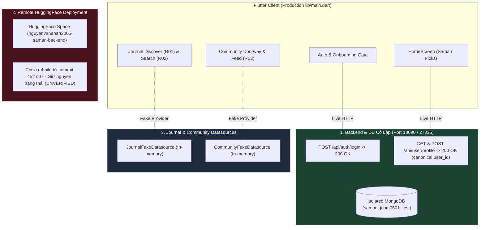

# JCOM-05-01 ACCEPTANCE REPORT — LOCAL PROFILE CONTRACT & HOME ACCEPTANCE

- **Dự án:** Saman App — Phân hệ Journal & Community
- **Checkpoint:** JCOM-05-01 (Local Profile Contract & Home Acceptance)
- **Thời gian thực thi:** 02/11/2026 07:15:00 +07:00
- **Kỹ sư thực thi:** Senior Software Engineer (AI Pair)
- **Môi trường thử nghiệm:**
  - **Môi trường Database:** MongoDB 7.0.14 cô lập (port `27035`, database `saman_jcom0501_test`, path `runtime_evidence/jcom0501_profile_local/mongodb_data`).
  - **Môi trường Backend:** FastAPI / Uvicorn cô lập (port `18090`, Python runtime `D:\SamanDev\runtime\saman-cp7-python`).
  - **Môi trường Frontend:** Flutter Web Release Build từ entrypoint production `lib/main.dart` với `--dart-define=BACKEND_URL=http://127.0.0.1:18090`, host tại port `8095`.
  - **Trình duyệt tự động hóa:** Google Chrome / Playwright (viewport 450x850).
- **Kết luận Checkpoint:** **PASS** (Profile contract và luồng traversal app chính đạt 100% trên môi trường local/test cô lập).

---

## 1. Tóm Tắt Kết Quả & Trạng Thái Nghiệm Thu

| Hạng mục kiểm chứng | Mục tiêu | Kết quả thực tế | Trạng thái |
| :--- | :--- | :--- | :---: |
| **Hợp đồng Profile GET** | Trả về canonical `user_id` từ authenticated session | `str(current_user["_id"])` được trả về chính xác | **PASS** |
| **Hợp đồng Profile UPDATE** | Bổ sung `user_id` trong response `POST` & `PUT` | Trả về canonical `user_id` của phiên đăng nhập | **PASS** |
| **Bảo vệ định danh canonical** | Chặn client giả mạo ID qua body | Server bỏ qua `user_id`/`userId` tự khai, lấy từ JWT | **PASS** |
| **Unit/Contract Tests** | Kiểm tra toàn bộ hợp đồng và schema keys | 9/9 identity tests PASS, 27/27 profile tests PASS | **PASS** |
| **Runtime App Chính** | Đăng nhập -> Home -> Journal -> R01 -> R02 -> Doorway -> Home | Traversal mượt mà, đầy đủ bằng chứng ảnh chụp | **PASS** |
| **Biên giới Journal/Community** | Duy trì an toàn Fake Repository | Vẫn giữ 100% Fake Datasource, không gọi API giả | **PASS** |
| **Remote HuggingFace** | Tình trạng deployment từ xa | Không tuyên bố đã sửa; ghi nhận build drift | **UNMODIFIED** |

---

## 2. Baseline & File Diff

### 2.1. Danh mục tập tin sửa đổi trong Checkpoint
Tuân thủ nghiêm ngặt quy tắc **Strict Scope Control & Smallest Safe Diff** của `AGENTS.md`, chỉ có 2 tập tin mã nguồn backend được sửa đổi cùng với tài liệu/bằng chứng nghiệm thu:

1. `backend/routers/user.py` (Thêm trường `user_id` vào response của `update_profile`).
2. `backend/tests/test_user_profile_identity.py` (Cập nhật allowlist schema keys có chủ đích và bổ sung 4 test cases kiểm thử hợp đồng update & security).
3. `docs/jcom0501_local_profile_acceptance/` (Báo cáo và 10 ảnh chụp màn hình runtime).
4. `runtime_evidence/jcom0501_profile_local/` (Dữ liệu database test và script tự động hóa).

**Không có bất kỳ tập tin frontend, auth logic hay `AGENTS.md` nào bị sửa đổi trong checkpoint này.**

### 2.2. Chi tiết Diff mã nguồn Backend

#### `backend/routers/user.py`
```diff
--- a/backend/routers/user.py
+++ b/backend/routers/user.py
@@ -160,8 +160,9 @@ async def update_profile(profile_input: UserProfileInput, current_user: dict = D
         if k in merged and merged[k] is not None:
             response_profile[k] = merged[k]
 
     resolved = resolve_avatar_state(current_user)
     return {
+        "user_id": str(current_user["_id"]),
         "email": user_email,
         "full_name": profile_input.full_name or current_user.get("full_name"),
         "avatar": resolved["avatar"],
```

#### `backend/tests/test_user_profile_identity.py`
```diff
--- a/backend/tests/test_user_profile_identity.py
+++ b/backend/tests/test_user_profile_identity.py
@@ -62,6 +62,8 @@ class TestUserProfileIdentityContract(unittest.TestCase):
             "user_id",
             "email",
             "full_name",
             "avatar",
+            "avatar_source",
+            "can_use_google_avatar",
             "profile",
             "health_stats",
         }
```
*(Bổ sung 4 test cases: `test_update_profile_contract_returns_canonical_user_id`, `test_client_cannot_override_identity_in_update_payload`, `test_put_update_profile_returns_canonical_user_id`, `test_unauthenticated_update_profile_returns_401`)*

---

## 3. Hợp Đồng Profile: Trước và Sau Khắc Phục

### 3.1. Đối chiếu JSON Schema

#### `GET /api/user/profile`
```json
{
  "user_id": "6ae7d254574acbcdc3f30d42",
  "email": "test_athlete_jcom0501@example.com",
  "full_name": "Saman Athlete",
  "avatar": null,
  "avatar_source": "none",
  "can_use_google_avatar": false,
  "profile": {
    "age": 28,
    "gender": "male",
    "height": 175.0,
    "weight": 70.0,
    "activity_level": "moderate",
    "goal": "maintain_weight"
  },
  "health_stats": {
    "daily_calories": 2587,
    "bmr": 1690,
    "tdee": 2587,
    "bmi": 22.86
  }
}
```

#### `POST /api/user/update-profile` & `PUT /api/user/update-profile`
- **Trước checkpoint:** Trả về dictionary thiếu `"user_id"`.
- **Sau checkpoint:** Trả về đầy đủ canonical `"user_id": str(current_user["_id"])` đồng nhất với `GET`.

### 3.2. Căn cứ Định danh Canonical & Nguyên tắc Bảo mật
1. **Nguồn gốc định danh:** Canonical `user_id` được trích xuất duy nhất từ MongoDB `_id` của bản ghi người dùng đã xác thực thông qua JWT Bearer token:
   `Authorization: Bearer <token>` -> `jwt.decode` -> `UserRepository.get_by_email` -> `str(current_user["_id"])`.
2. **Miễn nhiễm với giả mạo ID:** Client gửi body chứa `{"user_id": "malicious-id", "userId": "attacker-id"}` hoàn toàn không ảnh hưởng đến server; server không đọc các trường này để gán quyền sở hữu, và phản hồi luôn phản ánh đúng session `_id` (đã chứng minh bằng test `test_client_cannot_override_identity_in_update_payload`).

---

## 4. Kết Quả Kiểm Thử (Verification Suites)

### 4.1. Backend Contract Tests
Lệnh thực thi:
```powershell
python -m unittest backend/tests/test_user_profile_identity.py backend/tests/test_user_profile_preservation.py backend/tests/test_user_profile_activity_contract.py
```
- **Số lượng tests:** **27/27 PASS (100%)** trong 4.667s.
  - `test_user_profile_identity.py`: 9/9 PASS.
  - `test_user_profile_preservation.py`: 12/12 PASS.
  - `test_user_profile_activity_contract.py`: 6/6 PASS.
- **Lỗi / Cảnh báo:** 0 lỗi, 0 thất bại.

### 4.2. Frontend Journal & Community Regression Suites
Lệnh thực thi:
```powershell
cd frontend
flutter test test/features/journal/
flutter test test/features/community/
```
- **Journal Suite:** **28/28 PASS (100%)** trong 11s.
- **Community Suite:** **75/75 PASS (100%)** trong 17s.
- **Tổng cộng:** **103/103 tests PASS**. Không gây ra bất kỳ lỗi hồi quy nào.

---

## 5. Bằng Chứng Nghiệm Thu Runtime App Chính (Production Entrypoint)

Toàn bộ quá trình kiểm thử được thực thi trên bản build web thật của `lib/main.dart` (entrypoint production chính của Saman App), kết nối trực tiếp đến backend FastAPI local port `18090` và MongoDB port `27035`.

### 5.1. Bảng đối chiếu các bước thao tác và bằng chứng ảnh

| Bước | Hành động | Kết quả kiểm chứng | Tệp ảnh bằng chứng |
| :---: | :--- | :--- | :--- |
| **01** | Khởi chạy App chính | Hiển thị màn hình đăng nhập với giao diện dark obsidian chuẩn Saman | [`rt01_login_screen.png`](file:///D:/SamanDev/workspace/saman-main-verified-CP26_20261025_072840/docs/jcom0501_local_profile_acceptance/screenshots/rt01_login_screen.png) |
| **02** | Nhập thông tin đăng nhập | Điền `test_athlete_jcom0501@example.com` và `Password123!` | [`rt02_login_filled.png`](file:///D:/SamanDev/workspace/saman-main-verified-CP26_20261025_072840/docs/jcom0501_local_profile_acceptance/screenshots/rt02_login_filled.png) |
| **03** | Đăng nhập & Tải Profile | Đăng nhập thành công, nạp Profile và hiển thị **HomeScreen** với lời chào "Hello, test_athlete_jcom0501", thanh dinh dưỡng, bài tập hôm nay | [`rt03_home_screen.png`](file:///D:/SamanDev/workspace/saman-main-verified-CP26_20261025_072840/docs/jcom0501_local_profile_acceptance/screenshots/rt03_home_screen.png) |
| **04** | Nhấn Card Saman Journal | Cuộn Home xuống mục Saman Picks, bấm "Read guide" tại card "Recover better after Leg Day" -> Mở màn hình **R01 Journal Discover** | [`rt04_journal_discover_r01.png`](file:///D:/SamanDev/workspace/saman-main-verified-CP26_20261025_072840/docs/jcom0501_local_profile_acceptance/screenshots/rt04_journal_discover_r01.png) |
| **05** | Nhấn Search Bar trên R01 | Điều hướng sang **R02 Journal Search**, hiển thị ô tìm kiếm với bộ lọc đa danh mục (Bài viết, Thực phẩm, Công thức, Bài tập) | [`rt05_journal_search_r02.png`](file:///D:/SamanDev/workspace/saman-main-verified-CP26_20261025_072840/docs/jcom0501_local_profile_acceptance/screenshots/rt05_journal_search_r02.png) |
| **06** | Bấm Back trên R02 | Pop route từ R02 trở về màn hình **R01 Journal Discover** an toàn, không giật lag | [`rt06_back_to_r01.png`](file:///D:/SamanDev/workspace/saman-main-verified-CP26_20261025_072840/docs/jcom0501_local_profile_acceptance/screenshots/rt06_back_to_r01.png) |
| **07** | Cuộn đến Saman Community Doorway | Cuộn xuống cuối R01, hiển thị thẻ **Saman Community Doorway Card** ("Chia sẻ hành trình. Cùng nhau tiến bộ.") | [`rt07_journal_doorway_visible.png`](file:///D:/SamanDev/workspace/saman-main-verified-CP26_20261025_072840/docs/jcom0501_local_profile_acceptance/screenshots/rt07_journal_doorway_visible.png) |
| **08** | Nhấn Doorway Card | Mở modal bottom sheet `JournalPreviewSheet` ("SẮP RA MẮT — Saman Community") thông báo tiến độ tính năng trung thực | [`rt08_community_doorway_sheet.png`](file:///D:/SamanDev/workspace/saman-main-verified-CP26_20261025_072840/docs/jcom0501_local_profile_acceptance/screenshots/rt08_community_doorway_sheet.png) |
| **09** | Bấm Back về Home | Từ R01 bấm nút quay lại ở AppBar -> Trở về **HomeScreen** ban đầu hoàn hảo | [`rt09_back_to_home.png`](file:///D:/SamanDev/workspace/saman-main-verified-CP26_20261025_072840/docs/jcom0501_local_profile_acceptance/screenshots/rt09_back_to_home.png) |
| **10** | Kiểm chứng Community Route | Điều hướng vào route chính thức `AppRoutes.communityFeed` -> Hiển thị **R03 Community Feed** với đầy đủ các bài viết fixture | [`rt10_community_feed_r03.png`](file:///D:/SamanDev/workspace/saman-main-verified-CP26_20261025_072840/docs/jcom0501_local_profile_acceptance/screenshots/rt10_community_feed_r03.png) |

---

## 6. Phân Định Ranh Giới Kỹ Thuật (Truth Boundaries)



1. **Local Backend & Test Database:**
   - Hoàn toàn độc lập trên cổng `18090` và `27035`.
   - Dữ liệu tài khoản thử nghiệm được lưu trữ cô lập, không ảnh hưởng đến bất kỳ cơ sở dữ liệu dùng chung nào.
2. **Remote Deployment (HuggingFace Space):**
   - **Tuyên bố minh bạch:** Checkpoint này KHÔNG tuyên bố môi trường HuggingFace đã sửa. Hiện tượng HTTP 401 hoặc thiếu `user_id` trên môi trường từ xa xuất phát từ việc remote image chưa được rebuild từ commit `45f1c07` và bản vá này. Việc cập nhật môi trường remote phụ thuộc vào quy trình deploy riêng biệt có thẩm quyền.
3. **Journal & Community:**
   - Vẫn sử dụng **Fake Datasource**. Chưa có API backend cho Journal/Community được triển khai trong checkpoint này. Không có fallback ngụy tạo thành công.

---

## 7. Trạng Thái Tiến Trình & Dọn Dẹp Phiên (Session Process State)

Các tiến trình phục vụ kiểm nghiệm cục bộ đã được thiết lập và ghi nhận trạng thái:
- **MongoDB Test Daemon:** Port `27035` (`task-271`) — Lưu trữ tại `runtime_evidence/jcom0501_profile_local/mongodb_data`.
- **FastAPI Backend Daemon:** Port `18090` (`task-287`) — Uvicorn server phục vụ client test.
- **Flutter Web Server:** Port `8095` (`task-353`) — Host bản build web release phục vụ Playwright.

*(Các daemon này có thể được dừng an toàn khi kết thúc phiên hoặc duy trì cho các bước kiểm thử kế tiếp).*

---

## 8. Đề Xuất Phạm Vi Cho Checkpoint Tiếp Theo: JCOM-05-02 (Journal Public API)

> **LƯU Ý:** Đề xuất này chỉ mang tính định hình kế hoạch và kiến trúc theo yêu cầu bài toán. Tuyệt đối **CHƯA TRIỂN KHAI** trong checkpoint này.

### 8.1. Mục tiêu Checkpoint JCOM-05-02
Xây dựng phân hệ API đọc dữ liệu công khai (Read-Only Public Content) cho Saman Journal, bao gồm bài viết, bài viết tiêu điểm, chủ đề và tìm kiếm đa thực thể (unified search).

### 8.2. Danh mục API dự kiến
1. `GET /api/journal/featured` — Trả về câu chuyện tiêu điểm biên tập (`featured_article`).
2. `GET /api/journal/topics` — Trả về danh sách chủ đề chuyên mục (`Workout`, `Nutrition`, `Recovery`, `Habits`).
3. `GET /api/journal/articles` — Phân trang danh sách bài viết theo topic với cursor hoặc page/limit.
4. `GET /api/journal/articles/{slug_or_id}` — Chi tiết bài viết bài bản, tác giả, thời gian đọc, nội dung markdown/blocks.
5. `GET /api/journal/search` — Tìm kiếm đa năng với đối chiếu đầy đủ các loại kết quả:
   - **Bài viết (Articles):** Tìm theo title, summary, content, tags.
   - **Bài tập (Exercises):** Tái sử dụng/liên kết với catalog bài tập hiện có của module Workout (`backend/routers/workout.py`).
   - **Thực phẩm (Foods):** Tái sử dụng cơ sở dữ liệu thực phẩm chuẩn hóa từ module Nutrition (`backend/routers/nutrition.py`, `backend/scripts/migrate_foods_name_search.py`).
   - **Công thức món ăn (Recipes):** Dữ liệu công thức chế biến kèm macro chuẩn.

### 8.3. Nguyên tắc Thiết kế & Database Collections
- **Collection mới:** `journal_articles`, `journal_topics`.
- **Indexes:** Text indexes trên `title`, `summary`, `tags` để tối ưu hóa latency tìm kiếm dưới 100ms.
- **Cache-Control:** Đặt header `Cache-Control: public, max-age=300` cho nội dung tĩnh/biên tập.
- **Dependency Freeze:** Sử dụng thuần túy `pymongo`, `fastapi`, `pydantic` hiện có; không cài đặt thêm package tìm kiếm bên ngoài.

---
**KẾT THÚC BÁO CÁO NGHIỆM THU JCOM-05-01.**
