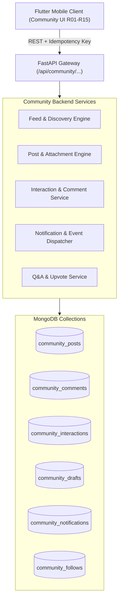

# TÀI LIỆU BÀN GIAO KỸ THUẬT JCOM-05 — BACKEND FASTAPI & DATABASE HANDOFF

**Dự án:** Saman App — Community & Journal Module  
**Checkpoint:** JCOM-05 (Backend API, Schemas & Idempotency Specification)  
**Thời gian lập:** 01/11/2026  
**Phạm vi:** Tài liệu đặc tả kỹ thuật và bàn giao (Technical Specification & Architecture Handoff).  
**Ghi chú tuân thủ AGENTS.md:** **NGHIÊM CẤM TRIỂN KHAI CODE BACKEND TRONG PHẠM VI NÀY.** Toàn bộ thư mục `backend/` và live database được giữ nguyên trạng thái đóng băng (Strict Freeze).

---

## 1. Tổng quan kiến trúc phân hệ Community

Phân hệ Community trên Frontend Flutter hiện đã hoàn thiện đầy đủ từ JCOM-01 đến JCOM-04 (`R01`–`R15`) và đang chạy qua `CommunityFakeDatasource` (In-memory contract).

Để đưa phân hệ Community lên môi trường production thực tế trong các giai đoạn sau (khi được cấp quyền backend), đội ngũ Backend cần triển khai các thành phần FastAPI và MongoDB tương thích 100% với các hợp đồng dữ liệu đã định hình.



---

## 2. Đặc tả các Endpoints FastAPI cần triển khai

### A. Feed & Khám phá
- `GET /api/community/feed`:
  - **Query Params**: `tab` (`all` | `qa` | `following` | `workout` | `nutrition`), `page` (int), `limit` (int), `last_id` (cursor-based pagination).
  - **Headers**: `Authorization: Bearer <token>`.
  - **Filter Rules**:
    - Khi `tab=following`: Chỉ trả về bài viết từ những `author_id` mà `current_user` đang theo dõi.
    - Quyền riêng tư: Chỉ trả về bài viết `public` hoặc `followers_only` nếu có quan hệ theo dõi; bài viết `private` chỉ tác giả mới thấy.
- `GET /api/community/discover`:
  - **Query Params**: `q` (search text), `category` (`topic` | `author` | `tag`).
  - Trả về danh sách chủ đề thịnh hành, bài viết nổi bật và gợi ý tác giả theo dõi.

### B. Quản lý Bài viết & Đính kèm (Media-First Posts)
- `POST /api/community/posts`:
  - **Headers**: `X-Idempotency-Key: <UUID>` (Bắt buộc).
  - **Request Body**:
    ```json
    {
      "caption": "string (max 2000 chars)",
      "media_urls": ["string"],
      "type": "regular | qa | milestone",
      "topics": ["string"],
      "privacy": "public | followers_only | private",
      "allow_comments": true,
      "attachment": {
        "type": "workout | meal",
        "reference_id": "string",
        "title": "string",
        "subtitle": "string",
        "metrics": {
          "duration_minutes": 45,
          "calories": 320,
          "include_load_or_macros": false
        }
      },
      "qa_info": {
        "question": "string",
        "topic": "string"
      }
    }
    ```
  - **Idempotency Handling**:
    - Backend kiểm tra khóa `X-Idempotency-Key` trong Redis/MongoDB TTL cache (24 giờ).
    - Nếu khóa đã tồn tại: Trả lại kết quả bài viết đã tạo trước đó kèm HTTP 200 (không tạo mới bản ghi trùng lặp).
    - Nếu khóa mới: Tiến hành tạo bài viết trong transaction và ghi nhớ khóa.
- `GET /api/community/posts/{post_id}`:
  - Chi tiết bài viết, tác giả, danh sách hình ảnh, đính kèm hoạt động và trạng thái tương tác của người dùng hiện tại (`is_liked`, `is_saved`).
- `DELETE /api/community/posts/{post_id}`:
  - Xóa mềm bài viết (`is_deleted: true`). Chỉ chủ bài viết hoặc Admin mới có quyền.

### C. Tương tác & Bình luận
- `POST /api/community/posts/{post_id}/like`:
  - Toggle trạng thái thích (like/unlike). Tự động cập nhật `likes_count` theo nguyên tử (`$inc`).
- `POST /api/community/posts/{post_id}/save`:
  - Toggle lưu bài viết vào danh sách bài viết đã lưu của người dùng.
- `GET /api/community/posts/{post_id}/comments`:
  - Danh sách bình luận theo dạng cây/phẳng, phân trang theo thời gian.
- `POST /api/community/posts/{post_id}/comments`:
  - **Headers**: `X-Idempotency-Key: <UUID>`.
  - **Body**: `{"content": "string", "reply_to_comment_id": "optional string"}`.
  - Gửi sự kiện tạo thông báo tới chủ bài viết.

### D. Thông báo & Bản nháp
- `GET /api/community/notifications`:
  - Trả về danh sách thông báo phân loại: `all`, `interactions`, `system`.
  - Trả về `unread_count`.
- `POST /api/community/notifications/mark-read`:
  - Body: `{"notification_ids": ["string"]}` hoặc `{"mark_all": true}`.
- `GET /api/community/drafts`:
  - Danh sách bản nháp của người dùng hiện tại.
- `POST /api/community/drafts`:
  - Lưu hoặc cập nhật bản nháp bài viết.
- `DELETE /api/community/drafts/{draft_id}`:
  - Xóa bản nháp khỏi hệ thống.

### E. Hồ sơ & Mạng lưới Theo dõi (Profile & Follows)
- `GET /api/community/authors/{author_id}`:
  - Thông tin tác giả, chức danh, verified status, số lượng follower/following, stats thể chất.
- `POST /api/community/authors/{author_id}/follow`:
  - Toggle theo dõi/bỏ theo dõi thành viên.
- `GET /api/community/authors/{author_id}/followers`:
  - Danh sách người theo dõi.
- `GET /api/community/authors/{author_id}/following`:
  - Danh sách đang theo dõi.

---

## 3. Thiết kế Lược đồ Dữ liệu MongoDB (Schema Definitions)

### A. Collection `community_posts`
```json
{
  "_id": "ObjectId",
  "author_id": "string (indexed)",
  "author_name": "string",
  "author_avatar": "string",
  "caption": "string",
  "media_urls": ["string"],
  "type": "regular | qa | milestone",
  "topics": ["string (indexed)"],
  "privacy": "public | followers_only | private (indexed)",
  "allow_comments": true,
  "likes_count": 0,
  "comments_count": 0,
  "shares_count": 0,
  "attachment": {
    "type": "workout | meal",
    "reference_id": "string",
    "title": "string",
    "subtitle": "string",
    "metrics": {
      "duration_minutes": 45,
      "calories": 320,
      "include_load_or_macros": false
    }
  },
  "qa_info": {
    "question": "string",
    "topic": "string",
    "upvotes_count": 0,
    "answers_count": 0
  },
  "created_at": "ISODate (indexed)",
  "updated_at": "ISODate",
  "is_deleted": false
}
```
**Chỉ mục cần thiết (Indexes):**
- `{ "created_at": -1, "privacy": 1 }`
- `{ "author_id": 1, "created_at": -1 }`
- `{ "topics": 1 }`
- `{ "type": 1, "qa_info.topic": 1 }`

### B. Collection `community_comments`
```json
{
  "_id": "ObjectId",
  "post_id": "ObjectId (indexed)",
  "author_id": "string (indexed)",
  "author_name": "string",
  "author_avatar": "string",
  "author_role": "user | coach | verified",
  "content": "string",
  "reply_to_comment_id": "ObjectId (optional)",
  "upvotes_count": 0,
  "created_at": "ISODate (indexed)"
}
```

### C. Collection `community_interactions`
Lưu trữ trạng thái like, save, upvote để query nhanh `O(1)`:
```json
{
  "_id": "ObjectId",
  "user_id": "string",
  "target_type": "post_like | post_save | comment_upvote | qa_upvote",
  "target_id": "string",
  "created_at": "ISODate"
}
```
**Chỉ mục duy nhất (Compound Unique Index):**
- `{ "user_id": 1, "target_type": 1, "target_id": 1 }` (unique: true)

### D. Collection `community_follows`
```json
{
  "_id": "ObjectId",
  "follower_id": "string",
  "following_id": "string",
  "created_at": "ISODate"
}
```
**Chỉ mục duy nhất (Compound Unique Index):**
- `{ "follower_id": 1, "following_id": 1 }` (unique: true)

### E. Collection `community_notifications`
```json
{
  "_id": "ObjectId",
  "recipient_id": "string (indexed)",
  "actor_id": "string",
  "actor_name": "string",
  "actor_avatar": "string",
  "type": "like | comment | mention | qa_answer | follow | system",
  "action_text": "đã thích bài viết của bạn",
  "target_post_id": "string",
  "target_snippet": "string",
  "is_unread": true,
  "created_at": "ISODate (indexed)"
}
```

---

## 4. Đặc tả Cơ chế Chống Trùng lặp (Idempotency Key Protocol)

Trong môi trường mạng di động không ổn định (4G/5G chập chờn khi ở phòng tập), người dùng có thể gửi nhiều yêu cầu đăng bài trùng lặp:

1. **Khách hàng Flutter**:
   - Khi chuẩn bị gửi `publishPost` hoặc `submitAnswer`, sinh một mã UUID ngẫu nhiên `idempotency_key = uuid.v4()`.
   - Đính kèm header `X-Idempotency-Key: <key>` trong request HTTP.
2. **FastAPI Middleware**:
   - Kiểm tra collection `idempotency_keys`:
     ```json
     {
       "key": "b4728f32-...",
       "user_id": "user_123",
       "status": "processing | completed",
       "response_code": 201,
       "response_body": { "id": "post_999", ... },
       "created_at": "ISODate",
       "expire_at": "ISODate + 24h"
     }
     ```
   - Nếu `status == 'processing'`: Trả về `409 Conflict` (yêu cầu đang được xử lý).
   - Nếu `status == 'completed'`: Trả về nguyên trạng `response_body` và `response_code` trước đó mà không thực thi logic tạo bài viết mới.
   - Nếu chưa tồn tại: Đánh dấu `processing`, thực thi nghiệp vụ, cập nhật `completed` và trả về kết quả.

---

## 5. Quy tắc Lọc Quyền Riêng Tư (Audience & Data Privacy Enforcement)

Backend **phải bắt buộc thực thi ở tầng query**, không được phép chỉ dựa vào Client:

1. **Bộ lọc bài viết theo quyền riêng tư (`privacy`)**:
   ```python
   query = {
       "is_deleted": False,
       "$or": [
           {"privacy": "public"},
           {"author_id": current_user_id},
           {
               "privacy": "followers_only",
               "author_id": {"$in": followed_author_ids}
           }
       ]
   }
   ```
2. **Quyền riêng tư dữ liệu hoạt động (`include_load_or_macros`)**:
   - Nếu bài viết có đính kèm hoạt động và `include_load_or_macros == False`:
     - Tầng serialization của Backend **phải triệt tiêu (strip)** các trường nhạy cảm: `weight_kg`, `reps`, `sets`, `protein_g`, `fat_g`, `carbs_g` trước khi trả về cho người đọc.
     - Đảm bảo người dùng khác không thể xem lén thông số cá nhân qua payload JSON raw.

---

## 6. Trạng thái Hiện tại & Kế hoạch Tiếp nhận

- **Frontend Flutter**: Sẵn sàng 100% tích hợp. Khi backend sẵn sàng, chỉ cần thay thế `CommunityFakeDatasource` bằng `CommunityRemoteDatasource` kế thừa cùng interface `CommunityRepository`.
- **Backend FastAPI**: Đang ở trạng thái **ĐÓNG BĂNG HOÀN TOÀN** trong checkpoint này theo chỉ thị `AGENTS.md`. Chưa có file backend nào bị can thiệp.
- **Tiếp nhận bàn giao**: Đội ngũ Backend có thể sử dụng trực tiếp tài liệu này để xây dựng migration script và routers mà không sợ xung đột hợp đồng dữ liệu với Frontend.

---

## 7. Tài Liệu Nghiệm Thu Sẵn Sàng Tích Hợp (Readiness Report)

Báo cáo phân tích chuyên sâu về sự sẵn sàng tích hợp, khảo sát Profile contract, đối chiếu Capability map và chia phase triển khai chi tiết được lưu trữ tại:
👉 [`docs/jcom05_backend_handoff/JCOM05_READINESS_REPORT.md`](file:///d:/SamanDev/workspace/saman-main-verified-CP26_20261025_072840/docs/jcom05_backend_handoff/JCOM05_READINESS_REPORT.md)

