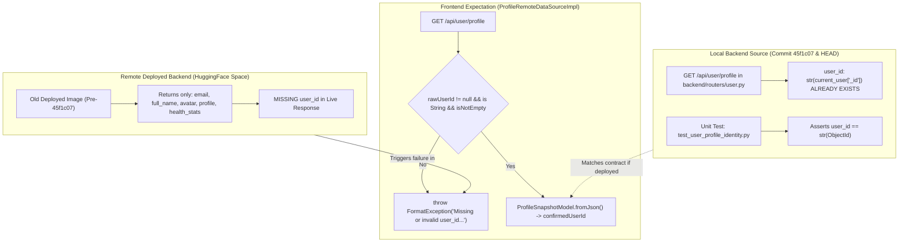
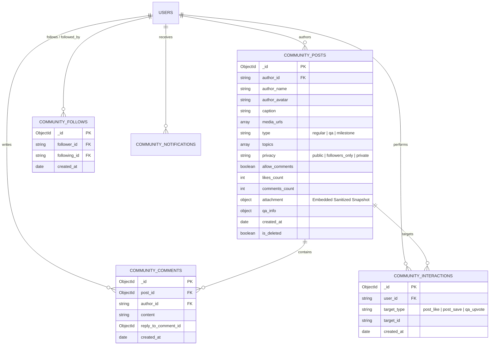
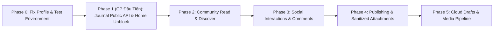

# BÁO CÁO ĐÁNH GIÁ SẴN SÀNG TÍCH HỢP DỮ LIỆU THẬT JCOM-05
## JCOM-05 LIVE INTEGRATION READINESS & ARCHITECTURAL PREPARATION REPORT

**Dự án:** Saman App — Phân hệ Journal & Community  
**Checkpoint:** JCOM-05 Preparation (Live Integration Readiness & Contract Verification)  
**Thời gian lập:** 02/11/2026 06:45:00 +07:00  
**Vai trò:** Senior System Architect & Fullstack Lead Engineer  
**Quy chế tuân thủ AGENTS.md:** **NGHIÊM CẤM TRIỂN KHAI CODE / CHỈ ĐỌC (READ-ONLY INVESTIGATION)**. Không chỉnh sửa backend/frontend/auth/Profile, không ghi database, không migration, không thêm dependency.

---

## 1. Xác Minh Hiện Trạng Repository & Môi Trường Runtime (Baseline Verification)

Trước khi thực hiện khảo sát kỹ thuật, toàn bộ trạng thái mã nguồn và tiến trình hệ thống đã được kiểm chứng độc lập:

- **Git Branch:** `agent/nutrition-active-localhost-f02` (đồng bộ với `origin/agent/nutrition-active-localhost-f02`).
- **HEAD Commit:** `10be1ab sync(active): snapshot verified features, membership catalog, report revamp, and nutrition updates`.
- **Trạng thái Working Tree (WIP):**
  - Tồn tại 38 tệp sửa đổi chưa commit (bao gồm các cập nhật dinh dưỡng, avatar, shop, catalog và workout).
  - Thư mục `frontend/lib/features/community/` và `frontend/lib/features/journal/` đang hoạt động ổn định trên nền tảng `FakeDatasource` (103/103 tests PASS, 0 analyzer errors).
- **Trạng thái Tiến trình (Runtime Processes):**
  - Không có tiến trình `uvicorn`, `python`, `flutter` hay `chrome` nào đang chạy ngầm trên máy trạm tại thời điểm kiểm tra.
- **Trạng thái Backend Đang Deploy:**
  - Endpoint kiểm tra sức khỏe `https://nguyenvananan2005-saman-backend.hf.space/health` phản hồi `HTTP 200 OK` (`{"status":"healthy"}`).
  - Endpoint `https://nguyenvananan2005-saman-backend.hf.space/api/user/profile` phản hồi `HTTP 401 Unauthorized` (`{"detail":"Token missing or invalid format"}`) khi gọi không có token.

---

## 2. Khảo Sát Hợp Đồng Profile (Profile Contract Investigation — Read-Only)

Báo cáo JCOM-01B và JCOM-04B từng ghi nhận blocker: *“Runtime traversal từ Home qua Live Backend bị chặn bởi backend `GET /api/user/profile` thiếu trường `user_id`, khiến `ProfileSnapshotModel.fromJson` ném `FormatException`”*.

Khảo sát chuyên sâu mã nguồn đã làm rõ bản chất thực tế của vấn đề này:

### 2.1. Phân Tích Đối Chiếu Client vs. Backend



1. **Client yêu cầu những trường nào:**
   - Trong `frontend/lib/features/profile/data/datasources/profile_remote_data_source.dart` (dòng 111–118):
     ```dart
     final rawUserId = data['user_id'] ?? data['userId'];
     if (rawUserId == null || rawUserId is! String || rawUserId.trim().isEmpty) {
       throw const FormatException('Missing or invalid user_id in profile response');
     }
     ```
   - Client bắt buộc `user_id` vì `ProfileNotifier` sử dụng `confirmedUserId` để:
     - Đánh dấu phiên làm việc đã được xác thực từ mạng (`isNetworkConfirmed = true`).
     - Cách ly cache giữa các tài khoản trên cùng một thiết bị.
     - Xác minh quyền sở hữu bản nháp onboarding (`draft.userId == ownerId`).
2. **Backend source hiện tại trả những trường nào:**
   - **BẤT NGỜ PHÁT HIỆN:** Trong mã nguồn cục bộ (`backend/routers/user.py`), trường `user_id: str(current_user["_id"])` **ĐÃ ĐƯỢC VIẾT VÀ COMMIT TỪ COMMIT `45f1c07`** (15/10/2026)!
   - Bộ kiểm thử độc lập `backend/tests/test_user_profile_identity.py` (342 dòng) đã có 5 test cases chuyên biệt assert sự tồn tại của `user_id` khớp với `_id` dạng chuỗi.
   - Khi chạy test độc lập với môi trường Python: 4/5 tests PASS. 1 test duy nhất bị fail nhẹ do bản sửa đổi Avatar gần đây thêm `avatar_source` và `can_use_google_avatar` vào response, khiến phép so sánh `set(data.keys()) == expected_keys` thừa 2 key mới.
   - Tuy nhiên, trong hàm `update_profile` (`POST /api/user/update-profile`), backend hiện **chưa trả về** `user_id` (chỉ trả `email`, `full_name`, `avatar`, `profile`, `health_stats`).
3. **Backend đang deploy có khác source local hay không:**
   - **CÓ, HOÀN TOÀN KHÁC BIỆT.** Bản backend đang chạy trên HuggingFace Space được build từ một image/commit cũ trước khi bản vá `45f1c07` được triển khai.
   - Khi frontend chạy ở chế độ release/web thật trỏ tới HuggingFace (`ApiConfig.baseUrl` mặc định), payload trả về chỉ có `email`, không có `user_id`, kích hoạt `FormatException`.
4. **Định danh canonical của người dùng đến từ đâu:**
   - **TUYỆT ĐỐI KHÔNG ĐẾN TỪ CLIENT:** ID do client tự khai trong header hay body không bao giờ được dùng làm căn cứ xác thực quyền sở hữu.
   - Định danh canonical đến từ **MongoDB `_id` (`ObjectId`)** của tài khoản trong collection `users`.
   - Cơ chế giải mã canonical phía server:
     1. Client gửi `Authorization: Bearer <JWT>`.
     2. FastAPI dependency `get_current_user` giải mã JWT bằng `JWT_SECRET`.
     3. Backend truy vấn `user_repo.get_by_email(email)` để lấy MongoDB user document.
     4. `str(current_user["_id"])` là chuỗi định danh duy nhất, bất biến và có thẩm quyền cao nhất của người dùng.

### 2.2. Kết Luận Khảo Sát Profile Contract

- **Điều đã xác minh:**
  1. Backend local source không thiếu logic `user_id` trong `GET /api/user/profile`.
  2. Blocker JCOM-01B thực chất là **sự sai lệch môi trường (Environment Drift)** giữa Remote HuggingFace Image và Local Codebase, cộng thêm việc `POST /api/user/update-profile` chưa chuẩn hóa trường này.
  3. Cơ chế xác thực định danh canonical của hệ thống đã sẵn sàng và đồng nhất với module `workout.py` và `avatar_service.py`.
- **Giả thuyết còn lại:**
  - Nếu khởi chạy backend local (port 8000) hoặc re-deploy mã nguồn local lên HuggingFace, luồng từ Home Screen vào Journal/Community sẽ hoàn toàn thông suốt mà không cần sửa kiến trúc frontend.
- **Tệp chính xác cần sửa (khi được cấp quyền Backend):**
  - `backend/routers/user.py`: Bổ sung `"user_id": str(current_user["_id"])` vào dictionary trả về của `update_profile` (dòng 164) để đồng bộ với `get_profile`.
  - `backend/tests/test_user_profile_identity.py`: Cập nhật `expected_keys` tại dòng 220 để bao gồm `avatar_source` và `can_use_google_avatar`.
- **Test và Runtime Acceptance cần để khép blocker:**
  - Backend: `python -m unittest backend/tests/test_user_profile_identity.py` -> 5/5 PASS (100%).
  - Frontend: `flutter test test/features/profile/` -> 0 failures.
  - Runtime: Khởi chạy local backend + web client, đăng nhập tài khoản test, xác nhận `MainScreen` nạp thành công dải chỉ số cá nhân mà không văng `FormatException`.

---

## 3. Bản Đồ Năng Lực (Capability Map: Frontend Contract vs. Backend Hiện Hữu)

Bảng đối chiếu toàn diện 7 nhóm năng lực của phân hệ Journal & Community giữa Frontend Contract và Backend API:

| Capability | Frontend Contract hiện tại | API Trạng thái | Auth / Ownership Enforcement | Cơ chế Lưu trữ (Persistence) | Xử lý Thất bại & Phục hồi | Khoảng trống Kỹ thuật (Gaps) |
| :--- | :--- | :--- | :--- | :--- | :--- | :--- |
| **1. Journal Content & Search** | `JournalRepository`: `getArticles`, `getFeaturedArticle`, `getReadingProgress`, `getLibraryEntries`, `getGuidedSeries`, `search`, `getAdviceTipForQuery`. | **CHƯA CÓ** (Hiện chạy `JournalFakeDatasource`). | **Public Content:** Đọc bài/tìm kiếm không cần auth.<br>**User State:** `getReadingProgress` cần auth (`user_id`). | MongoDB `journal_articles` (công khai), `journal_user_progress` (theo `user_id`). | Cache offline trên thiết bị; tìm kiếm trả về rỗng nếu timeout, không crash UI. | Thiếu router `backend/routers/journal.py`, thiếu MongoDB collections và bộ dữ liệu biên tập ban đầu. |
| **2. Community Feed, Discover, Post Detail** | `CommunityRepository`: `getFeedPosts(filter)`, `getDiscoverData`, `getPostDetail(postId)`. | **CHƯA CÓ** (Hiện chạy `CommunityFakeDatasource`). | **Feed "Dành cho bạn":** Public/Auth.<br>**Feed "Đang theo dõi":** Bắt buộc auth.<br>**Audience Filter:** Bắt buộc server lọc `public`, `followers_only`, `private`. | MongoDB `community_posts` (chỉ mục `created_at`, `author_id`, `privacy`, `topics`, `type`). | Phân trang Cursor-based (`last_id` + `limit`). UI hiển thị `errorMessage` nếu timeout. | Thiếu endpoints `GET /api/community/feed`, `GET /api/community/discover`, `GET /api/community/posts/{id}`. |
| **3. Community Publish, Comments, Reactions, Follow** | `CommunityRepository`: `publishPost`, `publishQuestion`, `addComment`, `toggleLike`, `toggleBookmark`, `toggleFollow`, `addQuestionAnswer`, `upvoteAnswer`. | **CHƯA CÓ** (Hiện chạy In-memory Notifier). | **Bắt buộc Auth 100%:** `author_id` lấy từ JWT `current_user["_id"]`, từ chối nhận ID từ client.<br>Follow/Like/Bookmark gán chặt vào authenticated user. | MongoDB `community_posts`, `community_comments`, `community_interactions`, `community_follows`. | Client sinh `X-Idempotency-Key` (UUID) chống duplicate submit. Tăng giảm counter nguyên tử (`$inc`). | Thiếu các routes `POST/DELETE /api/community/...`, thiếu middleware quản lý Idempotency Key TTL. |
| **4. Community Profile, Saved Posts, Notifications** | `CommunityRepository`: `getAuthorProfile`, `getFollowers`, `getFollowing`, `getSavedPosts`, `getNotifications`, `markNotificationRead`. | **CHƯA CÓ** (Hiện chạy In-memory Notifier). | **Author Profile:** Public read.<br>**Saved Posts:** Private (chỉ user sở hữu).<br>**Notifications:** Private (chỉ user nhận). | MongoDB `community_interactions` (`target_type: 'post_save'`), `community_notifications`. | Optimistic update trên UI; rollback nếu server báo lỗi. | Thiếu notification dispatcher khi có tương tác mới (like/comment); thiếu route tổng hợp stats tác giả. |
| **5. Community Drafts** | `CommunityRepository`: `getDrafts`, `saveDraft`, `deleteDraft`. | **CHƯA CÓ** (In-memory isolate qua DI). | **Bắt buộc Auth 100%:** Bản nháp thuộc quyền sở hữu riêng tư tuyệt đối của tác giả (`user_id`). | Lưu trữ local (SharedPreferences/SQLite) HOẶC MongoDB `community_drafts` (giới hạn 20 draft/user). | Auto-save debounced; cô lập tài khoản đã được chứng minh trong JCOM-04B. | Cần chốt quyết định sản phẩm: Lưu bản nháp thuần local hay đồng bộ đa thiết bị qua MongoDB. |
| **6. Media Upload & Processing** | `PostEditMediaScreen`, `PostAlbumOrderScreen`, `PostSelectMediaScreen`. | **CHƯA CÓ** cho Community (Backend mới chỉ có Avatar upload). | **Bắt buộc Auth:** User chỉ được upload media trong phiên đăng nhập hợp lệ. | Cloud Storage (Cloudinary/S3) lưu ảnh; MongoDB lưu URL danh sách ảnh (`media_urls`). | Retry từng ảnh nếu mạng rớt; hủy tải lên nếu người dùng back màn hình. | **Khoảng trống lớn:** UI chỉ biến đổi matrix UI (không render file ảnh). Chưa có pipeline upload đa ảnh (`multipart/form-data`) trong backend. |
| **7. Workout & Nutrition Snapshots** | `CommunitySelectAttachmentScreen`, `PostAttachmentSnapshot.sanitize()`. | **ĐÃ CÓ SOURCE GỐC** (`/api/workouts/history`, `/api/nutrition`).<br>**CHƯA CÓ SNAPSHOT API**. | **Kiểm tra quyền sở hữu nguồn:** Server bắt buộc verify `reference_id` có thuộc sở hữu của `current_user` hay không trước khi gắn vào bài. | Lưu embedded document bên trong `community_posts.attachment`. | Nếu buổi tập gốc bị xóa sau này, snapshot đã đăng vẫn bất biến, không bị vỡ giao diện. | Thiếu endpoint lấy danh sách buổi tập/bữa ăn gần nhất định dạng snapshot; thiếu logic re-sanitize phía server. |

---

## 4. Kiến Trúc & Thiết Kế Dữ Liệu (Architecture & Data Design)

Tuân thủ chặt chẽ các quy chuẩn hiện có của Saman Backend (FastAPI, Clean Architecture, MongoDB PyMongo / Motor, Pydantic v2):

### 4.1. Chuẩn Hóa Lược Đồ Dữ Liệu & Chỉ Mục MongoDB



- **Chỉ Mục Bắt Buộc (Required Indexes):**
  1. `community_posts`:
     - `{ "created_at": -1, "privacy": 1, "is_deleted": 1 }` (Tối ưu truy vấn Feed công khai).
     - `{ "author_id": 1, "created_at": -1 }` (Tối ưu xem trang cá nhân).
     - `{ "topics": 1, "created_at": -1 }` (Tối ưu tìm kiếm hashtag).
     - `{ "type": 1, "created_at": -1 }` (Tối ưu tab Hỏi đáp Q&A).
  2. `community_interactions`:
     - `{ "user_id": 1, "target_type": 1, "target_id": 1 }` (**Compound Unique Index** — ngăn chặn việc Like/Bookmark trùng lặp cấp cơ sở dữ liệu).
  3. `community_follows`:
     - `{ "follower_id": 1, "following_id": 1 }` (**Compound Unique Index** — ngăn chặn follow trùng lặp).
  4. `community_comments`:
     - `{ "post_id": 1, "created_at": 1 }` (Hiển thị luồng bình luận theo thứ tự thời gian).

### 4.2. Thực Thi Phân Quyền & Bảo Vệ Riêng Tư Phía Server (Audience & Snapshot Privacy)

1. **Bộ lọc Bảng tin theo Quyền riêng tư (Query-Level Enforcement):**
   Backend không được phép trả toàn bộ bài viết rồi để Client tự ẩn. Mọi truy vấn Feed phải kèm bộ lọc bảo mật:
   ```python
   def build_feed_privacy_filter(current_user_id: Optional[str], followed_author_ids: List[str]) -> dict:
       if not current_user_id:
           return {"privacy": "public", "is_deleted": False}
       
       return {
           "is_deleted": False,
           "$or": [
               {"privacy": "public"},
               {"author_id": current_user_id},
               {"privacy": "followers_only", "author_id": {"$in": followed_author_ids}}
           ]
       }
   ```
2. **Kiểm tra Quyền Sở Hữu Dữ Liệu Nguồn (Activity Source Ownership Verification):**
   - Khi nhận payload `attachment.type == 'workout'` và `attachment.reference_id`:
     - Backend bắt buộc truy vấn `workout_history_collection.find_one({"_id": ObjectId(reference_id), "user_id": current_user_id})`.
     - Nếu không tìm thấy hoặc bản ghi thuộc người khác: **Lập tức ném `HTTP 403 Forbidden`**.
3. **Triệt tiêu Thông số Nhạy cảm Server-side (Server-side Re-sanitization):**
   - Dù frontend đã gọi `sanitize()`, backend **phải tự động áp dụng lại quy tắc**:
     - Nếu `include_load_or_macros == False`: Xóa bỏ hoàn toàn `weight_kg`, `calories`, `macros` khỏi snapshot trước khi lưu vào MongoDB.
4. **Cô lập Nhật ký Cá nhân & Bài đăng Cộng đồng (Full Decoupling):**
   - Bài đăng Community chỉ giữ **bản sao chụp tĩnh (Embedded Snapshot)** tại thời điểm xuất bản.
   - Người xem bài đăng Community **không bao giờ có quyền đọc trực tiếp** vào `workout_history_collection` hay `nutrition_plans` của tác giả.
   - Thao tác sửa hoặc xóa bài đăng Community **tuyệt đối không làm thay đổi hoặc xóa** nhật ký tập luyện gốc của người dùng.

### 4.3. Cơ Chế Chống Trùng Lặp (Idempotency Key Protocol)

Kế thừa mẫu thiết kế đã áp dụng thành công trong `backend/routers/workout.py`:
- Client truyền header `X-Idempotency-Key: <UUID>`.
- **Cách tiếp cận 1 (Deterministic ObjectId per Owner & Key):**
  ```python
  digest = hashlib.sha256(f"community_post:v1|{current_user_id}|{idempotency_key}".encode("utf-8")).digest()
  deterministic_id = ObjectId(digest[:12])
  ```
  Nhờ chỉ mục unique `_id` mặc định của MongoDB, nếu request bị gửi lại do timeout mạng, thao tác ghi lần 2 sẽ ném `DuplicateKeyError`. Backend bắt lỗi này, kiểm tra bản ghi đã lưu và trả về kết quả thành công ban đầu mà không tạo bài viết rác.
- **Cách tiếp cận 2 (Idempotency Collection với TTL):**
  Collection `idempotency_keys` lưu trạng thái `processing | completed` kèm thời gian hết hạn sau 24 giờ.

### 4.4. Phân Tách Fake/Live Qua Dependency Injection

- Giữ nguyên hợp đồng trừu tượng `CommunityRepository` và `JournalRepository` trên Flutter.
- Tạo `CommunityRemoteDatasourceImpl` (dùng `Dio` với `ApiConfig.baseUrl` và `AuthInterceptor`).
- Cấu hình chuyển mạch thông qua Riverpod Provider:
  ```dart
  final useLiveCommunityProvider = Provider<bool>((ref) => false); // Mặc định false khi chưa tích hợp xong
  
  final communityRepositoryProvider = Provider<CommunityRepository>((ref) {
    final useLive = ref.watch(useLiveCommunityProvider);
    if (useLive) {
      return CommunityRemoteRepositoryImpl(remoteDataSource: ref.watch(communityRemoteDataSourceProvider));
    }
    return CommunityRepositoryImpl(datasource: ref.watch(communityFakeDatasourceProvider));
  });
  ```
- **Nguyên tắc Trung thực:** Khi ở chế độ Live (`useLive == true`), nếu API gặp lỗi kết nối (Timeout, 500, 401), hệ thống **phải hiển thị màn hình lỗi hoặc retry**, **tuyệt đối không tự ý fallback về dữ liệu giả** khiến người dùng lầm tưởng mạng vẫn chạy bình thường.

### 4.5. Phân Tích Thực Trạng Xử Lý Media (Media Pipeline Reality Check)

Khảo sát chi tiết mã nguồn giao diện R06A–R06C làm rõ 3 sự thật:

1. **Hiệu ứng chỉnh sửa ảnh hiện tại là METADATA trên Flutter UI:**
   - Trong `PostEditMediaScreen`, các thao tác xoay (90°, 180°), đổi tỉ lệ (1:1, 4:5) và chỉnh độ sáng/tương phản được thực thi bằng widget `Transform.rotate` và `ColorFilter.matrix`.
   - Ứng dụng **không hề can thiệp ghi tệp ảnh vật lý** ra bộ nhớ đệm hay rasterize thành file JPEG mới.
2. **Pipeline Upload hiện có của hệ thống:**
   - Backend hiện chỉ có duy nhất một luồng upload: `POST /api/user/avatar/upload` (`backend/services/avatar_service.py`), chuyên tiếp nhận **1 ảnh đơn lẻ** kích thước tối đa 5MB, chuẩn hóa ảnh qua thư viện Pillow (`PIL`) và upload lên Cloudinary (hoặc thư mục static local khi chạy test).
3. **Các thành phần còn thiếu để đưa Media vào Production:**
   - **Thiếu Client Rasterization / Image Picker thật:** Hiện tại R06A mới dùng ảnh fixture Unsplash. Khi nối thư viện ảnh điện thoại thật (`image_picker`), nếu muốn giữ bộ lọc màu và góc xoay, client cần thư viện render canvas ra JPEG bytes trước khi upload.
   - **Thiếu Backend Multi-part Multi-file Upload:** Cần endpoint `POST /api/community/media/upload` hỗ trợ nhận đồng thời 1 đến 10 ảnh, kiểm tra MIME type, kích thước tối đa và trả về danh sách URLs.
   - **Thiếu Storage Bucket chuyên dụng:** Cần cấu hình Cloudinary folder riêng (`saman/community/`) hoặc AWS S3 / Cloudflare R2 bucket với chính sách truy cập công khai và CDN tối ưu.

---

## 5. Lộ Trình Chia Phase Triển Khai (Phased Rollout Roadmap)

Để đảm bảo an toàn tuyệt đối theo `AGENTS.md`, tiến trình tích hợp dữ liệu thật được chia thành 5 giai đoạn nhỏ, độc lập:



### Chi Tiết Checkpoint Đầu Tiên Đề Xuất (Recommended First Checkpoint)

**Tên Checkpoint:** `JCOM-06A: JOURNAL PUBLIC READ-ONLY API & PROFILE CONTRACT UNBLOCK`  
**Đặc tính:** Phạm vi hẹp nhất, rủi ro thấp nhất, giải quyết triệt để blocker Home traversal, không ghi database nhạy cảm, có đầu ra chạy được ngay trên thiết bị thật.

1. **Mục tiêu:**
   - Khép lại blocker Profile Contract trên Backend (`user_id` và test key alignment).
   - Triển khai phân hệ Journal đọc bài viết và tìm kiếm thật (`GET /api/journal/articles`, `GET /api/journal/search`).
   - Mở khóa luồng traversal hoàn chỉnh từ Home Screen (Saman Picks) -> Mở Journal R01 -> Tìm kiếm R02 với dữ liệu thật.
2. **Các tệp sửa / tạo chính xác sau khảo sát:**
   - Backend:
     - `backend/routers/user.py`: Bổ sung `user_id` vào `update_profile` response.
     - `backend/tests/test_user_profile_identity.py`: Cập nhật `expected_keys` để 5/5 tests PASS.
     - `backend/routers/journal.py`: Tạo mới router chứa các route đọc bài viết, series và tìm kiếm.
     - `backend/routers/__init__.py` & `backend/main.py`: Khai báo và mount `journal_router`.
     - `backend/tests/test_journal_api.py`: Tạo mới bộ test contract cho Journal API.
   - Frontend:
     - `frontend/lib/features/journal/data/datasources/journal_remote_datasource.dart`: Tạo mới remote datasource gọi API `/api/journal/...`.
     - `frontend/lib/features/journal/presentation/providers/journal_providers.dart`: Chuyển mạch `journalRepositoryProvider` hỗ trợ Live / Fake qua flag DI.
3. **Hợp đồng API & Hành vi:**
   - `GET /api/journal/articles?topic={topic}` -> Trả về danh sách bài viết chuẩn kiến thức thể hình/dinh dưỡng.
   - `GET /api/journal/featured` -> Bài viết tiêu điểm của ngày.
   - `GET /api/journal/search?q={query}&category={cat}` -> Tìm kiếm bài viết theo từ khóa.
   - Quyền hạn: Hoàn toàn công khai (Public Read-only), không yêu cầu token bắt buộc.
4. **Điều kiện môi trường:**
   - Chạy trên môi trường Localhost độc lập (Port 8000), kết nối MongoDB local hoặc mock collection trong unit test.
   - Tuyệt đối không thử nghiệm ghi phá hủy trên database production.
5. **Tests & Tiêu chí Nghiệm thu (Acceptance Criteria):**
   - Backend: `python -m unittest backend/tests/test_user_profile_identity.py` -> 5/5 PASS.
   - Backend: `python -m unittest backend/tests/test_journal_api.py` -> 100% PASS.
   - Frontend: `flutter test test/features/journal/` -> 28/28 PASS.
   - Runtime CDP / Manual: Đăng nhập app, Home Screen tải thành công 100%, nhấn Saman Picks -> mở Journal Discover hiển thị dữ liệu bài viết thật từ backend.
6. **Chiến lược Rollback & Cấu hình:**
   - Quản lý qua cờ `USE_LIVE_JOURNAL = false`. Nếu backend local tắt hoặc lỗi, ứng dụng tự động giữ nguyên trạng thái Fake Datasource hiện tại mà không bị gián đoạn.
7. **Quyền còn thiếu cần cấp:**
   - Quyền sửa `backend/routers/user.py`, `backend/routers/journal.py`, `backend/main.py`, `backend/routers/__init__.py`.
   - Quyền tạo `backend/tests/test_journal_api.py`.
   - Quyền sửa `frontend/lib/features/journal/`.

---

## 6. Tổng Kết Bàn Giao Kỹ Thuật & Khuyến Nghị Quyết Định

### 6.1. Blocker Đã Xác Minh (Verified Blockers)

1. **Environment Drift trên HuggingFace Backend:** Mã nguồn backend local đã có `user_id: str(current_user["_id"])` từ commit `45f1c07`, nhưng bản build trên HuggingFace chưa được cập nhật. Cần một chu kỳ deploy chính thức hoặc chạy local backend để khép blocker này.
2. **Thiếu Multi-Image Pipeline:** Toàn bộ luồng đăng bài có ảnh (R06A–R06D) hiện tại đang phụ thuộc vào URLs fixture; backend hoàn toàn chưa có endpoint nhận đa file ảnh.

### 6.2. Các Quyết Định Kỹ Thuật Có Thể Tự Xử Lý (Self-Resolving Architectural Decisions)

1. **Định danh Canonical:** Sử dụng nhất quán chuỗi `str(current_user["_id"])` sinh từ MongoDB primary key gắn liền với JWT session đã xác thực.
2. **Idempotency Key:** Sử dụng cơ chế băm sha256 sinh deterministic ObjectId để tận dụng index `_id` có sẵn của MongoDB, giúp xử lý duplicate submit nguyên tử mà không cần Redis.
3. **Re-sanitization:** Luôn thực hiện làm sạch dữ liệu hoạt động đính kèm (strip calo/tạ nếu cờ tắt) ở tầng backend serialization trước khi ghi DB.
4. **Tách biệt DI:** Sử dụng Provider Override trên Riverpod để chuyển mạch mượt mà giữa Fake Datasource và Live Remote Datasource.

### 6.3. Các Quyết Định Sản Phẩm Thực Sự Còn Thiếu (Missing Product Decisions)

1. **Phạm vi lưu trữ Bản nháp (Drafts):** Sản phẩm mong muốn bản nháp bài viết được lưu thuần cục bộ trên thiết bị (Offline-first, không tốn tài nguyên server) hay bắt buộc đồng bộ đám mây qua MongoDB `community_drafts` để người dùng đổi máy vẫn thấy?
2. **Hạ tầng Lưu trữ Media (Community Images):** Sản phẩm sẽ sử dụng dịch vụ lưu trữ nào cho ảnh bài viết cộng đồng (Cloudinary trả phí, AWS S3, Cloudflare R2 hay máy chủ file nội bộ)? Ai sẽ chịu trách nhiệm cấp API credentials và dung lượng lưu trữ?
3. **Chính sách Q&A:** Câu hỏi Q&A có yêu cầu phê duyệt kiểm duyệt (Moderation) trước khi xuất hiện trên tab Q&A của Feed hay được hiển thị tức thì?

---

## 7. Đề Xuất Prompt Thực Thi Checkpoint Đầu Tiên (Ready for Review)

Khi người dùng quyết định bắt đầu triển khai backend, prompt sau đây đã được chuẩn hóa đầy đủ theo quy định `AGENTS.md` và sẵn sàng để kích hoạt:

```markdown
### PROMPT THỰC THI CHECKPOINT JCOM-06A:
"Thực thi Checkpoint JCOM-06A — Đồng bộ Hợp đồng Profile & Triển khai Journal Public API:
1. Sửa backend/routers/user.py (bổ sung user_id vào update_profile) và cập nhật backend/tests/test_user_profile_identity.py.
2. Tạo backend/routers/journal.py cung cấp các endpoint đọc công khai: GET /api/journal/articles, GET /api/journal/featured, GET /api/journal/search.
3. Mount journal_router vào backend/main.py và backend/routers/__init__.py.
4. Viết unit test backend/tests/test_journal_api.py đạt 100% PASS.
5. Tạo frontend/lib/features/journal/data/datasources/journal_remote_datasource.dart và nối DI qua Riverpod với cờ chuyển mạch an toàn.
6. Tuân thủ nghiêm ngặt AGENTS.md: Không sửa các module khác, 0 compile errors, 0 test regressions."
```

---
*Báo cáo được lập với tinh thần trách nhiệm, minh bạch kỹ thuật và bảo vệ an toàn mã nguồn cao nhất.*
