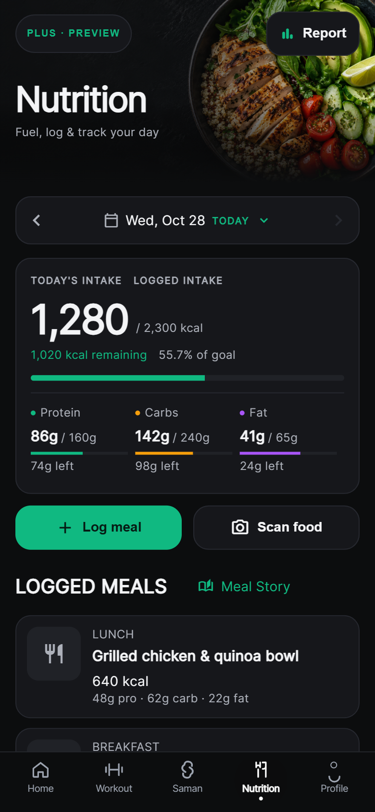
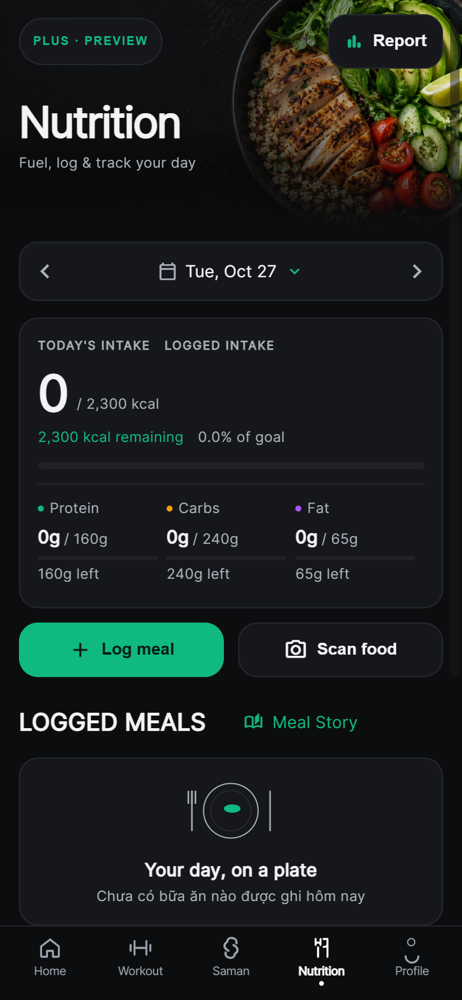

# Nutrition UI — tích hợp vào app thật

Thiết kế được duyệt từ worktree `saman-nutrition-ui-preview-20261028` đã được áp dụng vào **`frontend/lib/screens/nutrition/nutrition_screen.dart`** của repo app đang dùng. Không đưa entrypoint, fixture, ngày cố định hay thông báo của preview vào production.

## Source và cách mở

- Repo: `D:\SamanDev\workspace\saman-main-verified-CP26_20261025_072840`
- Branch giữ nguyên: `agent/nutrition-active-localhost-f02`.
- Entrypoint: `frontend/lib/main.dart`.
- Luồng thật: `AppRoutes.main` → `ProfileGate` → `MainScreen` → tab Nutrition index 3.
- Đã xác minh tiến trình app cũ cổng 3000 chạy từ `frontend` của đúng workspace này. Không dùng worktree preview làm app chính.
- Debug app đã tích hợp: **http://localhost:3000**. Đăng nhập bằng giao diện app như bình thường để kiểm tra dữ liệu tài khoản thật.
- Đã khởi động lại đúng frontend devserver cổng 3000 từ source tích hợp. Backend cổng 8000 giữ nguyên; không sửa cấu hình hoặc dừng emulator. Cổng debug phụ 18750 chỉ dùng trong giai đoạn kiểm tra và đã đóng.

Mở lại debug app từ PowerShell:

```powershell
Set-Location 'D:\SamanDev\workspace\saman-main-verified-CP26_20261025_072840\frontend'
flutter run --debug --no-pub -d web-server --web-renderer html --web-hostname localhost --web-port 3000 --target lib/main.dart --dart-define=BACKEND_URL=http://127.0.0.1:8000
```

SDK đã dùng: Flutter 3.22.0 / Dart 3.4.0. SDK này không có `flutter build web --debug`; debug được biên dịch và chạy bằng `flutter run --debug` ở trên.

Bản web tĩnh để review local cũng đã build thành công từ cùng `lib/main.dart`:

`frontend/build/nutrition_ui_integration/`

```powershell
flutter build web --no-pub --web-renderer html --target lib/main.dart --dart-define=BACKEND_URL=http://127.0.0.1:8000 --output build/nutrition_ui_integration
python -m http.server 3000 --bind 127.0.0.1 --directory build/nutrition_ui_integration
```

Bản tĩnh dùng chế độ release compile mặc định của Flutter, chỉ lưu local; không publish hosting/store. Bản chạy cổng 3000 hiện tại là debug. Chỉ serve bản tĩnh sau khi đã đóng debug bằng `q` trong terminal của nó.

Backend hiện tại cho phép origin cổng 3000; các cổng phụ bị từ chối CORS. Đó là lý do frontend chính được khởi động lại trên đúng cổng 3000. Kiểm tra cuối: app HTTP 200; preflight authorization/content-type/cache-control tới backend trả 204, không đổi backend hoặc CORS.

## Screenshot mới của bản tích hợp

**Nguồn dữ liệu trong các ảnh browser:** HTTP responses kiểm thử, được Playwright trả trong một browser context riêng. App chạy đầy đủ từ `lib/main.dart`, đi qua login, profile gate, MainScreen, repository và provider thật. Không có override/provider fixture trong app production và không gửi request ghi tới backend thật. Các ảnh này không chứng minh dữ liệu tài khoản thật hoặc backend thật đã được kiểm tra.

### Có bữa ăn



### Ngày trống sau khi đổi ngày



[Log meal](screenshots/full-app-log-meal.png), [Scan food](screenshots/full-app-scan-food.png), [Report route](screenshots/full-app-report-route.png), [meal details](screenshots/full-app-meal-details.png).

Ảnh mới được chụp từ bản tích hợp, không tái sử dụng screenshot của preview. Các ảnh Flutter test renderer kiểm tra màn 320 px, SafeArea và text scale 200% nằm trong thư mục evidence.

## Thay đổi

| File | Nội dung |
|---|---|
| `frontend/lib/screens/nutrition/nutrition_screen.dart` | Gắn hero, actions và empty state vào screen thật; giữ các callback và nhánh trạng thái hiện có; cho meal rows mở chi tiết chỉ đọc. |
| `frontend/lib/screens/nutrition/widgets/date_selector.dart` | Thanh ngày theo bố cục đã duyệt, target khoảng 58 px, giữ picker/TODAY/prev/next và điều kiện ngày tương lai. |
| `frontend/lib/screens/nutrition/widgets/nutrition_summary.dart` | Card nền đặc, calories lớn, macros dễ đọc; giữ nguồn dữ liệu, phép tính, cảnh báo vượt mục tiêu, trạng thái không có target và tiến độ từng macro. |
| `frontend/lib/screens/nutrition/widgets/nutrition_logged_meal_card.dart` | Layout meal rows theo thiết kế, tên và số liệu được wrap; giữ ảnh/thời gian lấy từ entry thật và fallback ảnh. |
| `frontend/lib/features/nutrition/presentation/widgets/nutrition_home_components.dart` | Các widget trình bày không phụ thuộc provider: hero, badge, actions, heading, empty plate và chi tiết entry chỉ đọc. |
| `frontend/lib/theme/nutrition_home_theme.dart` | Tokens/style chỉ trong Nutrition; không thay theme app. |
| `frontend/assets/images/nutrition/food-hero.png` | Asset food local được duyệt. |
| `frontend/pubspec.yaml` | Thêm một dòng khai báo asset; không đổi dependency/lockfile. |
| `frontend/test/features/nutrition/nutrition_ui_integration_test.dart` | Kiểm tra screen và navigation thật, binding provider, ngày, refresh, detail, text scale và fallback. |
| `frontend/test/features/nutrition/render_nutrition_integration_test.dart` | Render mới của production screen và bottom navigation hiện có, với dependency kiểm thử cô lập. |
| `docs/nutrition_ui_integration/` | Hướng dẫn, script browser, screenshots và verification summary. |

Đây cũng là `allowed_paths` đã công bố trước khi sửa. Các thay đổi khác vốn có trong workspace thuộc người dùng/agent khác; không đưa chúng vào commit. Task chưa tạo commit hoặc PR, không push/merge/release.

## Dữ liệu và hành vi được giữ

- Calories/macros lấy từ `NutritionPlan` qua `nutritionProvider`; targets lấy từ profile hiện có. Remaining, progress clamp, phần trăm và diff macro giữ công thức cũ.
- Chọn ngày gọi `_loadDataIfProfileReady`; prev/next và picker vẫn dùng ngày thực, không dùng ngày của preview.
- Report vẫn mở `WeeklyReportScreen`; Log meal mở `FoodLogScreen`; Scan food mở `LogMealSheet`; Meal Story mở `MealStoryScreen` với ngày đang chọn.
- Trả về thành công từ Log meal/Scan food vẫn reload ngày đang chọn.
- Giữ các nhánh loading, error/retry, profile incomplete, aggregate mismatch/Refresh, water intake và planned meal/Review & log.
- Giữ khóa chống nhấn lặp khi cập nhật nước/lưu meal; không sửa provider, camera permission hoặc logic lưu.
- Điều kiện và luồng sản phẩm PLUS/PREVIEW giữ như source cũ: badge nằm trong nhánh profile hợp lệ và mở upgrade sheet. Không lấy trạng thái membership từ fixture.
- Meal details hiển thị entry được chọn, calories/macros/foods thật theo model, không ghi dữ liệu.
- Giữ nguyên `SamanBottomNavigationBar` và MainScreen. Không thêm thanh điều hướng thứ hai vào Nutrition.

Hero cơ sở 190 logical px, tự nở theo text scaling; khoảng cách hero–calendar 14 px; padding ngang 16 px; radius card/calendar 16 px; nút min-height 54 px. Canvas `#0C0D0E`, card `#16171B`, viền `#26282F`, emerald `#10B981`. Card có thêm tiến độ/diff từng macro để giữ chức năng cũ.

Ảnh hero được sao chép nguyên từ asset đã duyệt trong preview; provenance/prompt ở `D:\SamanDev\workspace\saman-nutrition-ui-preview-20261028\docs\nutrition_ui_preview\SOURCES.md`. Không có URL ảnh hero khi chạy. Khi asset lỗi, lớp nền/gradient và toàn bộ chữ/nút vẫn render.

## Kiểm tra và giới hạn

Evidence: `D:\SamanDev\runtime_evidence\nutrition_ui_integration\20261028_084726\`.

- Baseline liên quan trước khi sửa: 37 pass / 2 fail trong nhóm home UI, logged card, provider và account isolation. Hai lỗi nằm ở account isolation/story.
- Sau tích hợp: 17/17 test UI Nutrition có sẵn pass, không đổi assertion của test cũ.
- 10/10 test mới (6 integration + 4 render) pass. Đã kiểm tra scale 2 bằng giá trị `MediaQuery` thật, không chỉ gắn nhãn ảnh.
- 320 px / 200%: nội dung tự nở và cuộn, tên meal được wrap, có SafeArea và bottom navigation thật. Đã sửa hai Row của empty planned-meal section sang Wrap vì chúng overflow ở điều kiện này; không đổi hành vi tạo kế hoạch.
- Test navigation xác minh ngày được truyền vào Log meal/Scan food, Report giữ route cũ; kết quả save-success trả về làm tăng số lần reload đúng ngày.
- Browser mới đi qua login/profile gate, chọn tab Nutrition, đổi ngày populated → empty → populated, mở Log meal, Scan food và Report. Mọi API call trong phép thử đều được chặn và trả HTTP test response tại browser; không dùng tài khoản hay token thật.
- Scoped analyze chỉ còn một info `use_build_context_synchronously` có sẵn trong phần lưu planned meal không sửa. Không có compile error hoặc warning mới trong phạm vi task.
- Analyze toàn workspace thay đổi đồng thời của nhiều agent: baseline 87 diagnostics, lần đo sau 82. Phân loại bằng path/rule, không coi thay đổi dòng trong profile/journey của agent khác là diff của task này.
- Full test batch đầu đã đạt 991 pass / 24 fail / 2 skipped rồi mắc ở test sinh screenshot Journey. Task dừng riêng cây process của batch đó. File render này không dùng prefix `render_`, nên lọt qua lệnh lọc mẫu; batch không-render tiếp theo loại riêng file đó theo mục 15 AGENTS.md. Các test nghiệp vụ không bị skip hoặc chỉnh sửa.
- Kết quả batch cuối và đối chiếu baseline xem `verification/verification-summary.json` cùng log đầy đủ trong evidence.
- Batch không-render hoàn tất: **992 pass / 2 skipped có sẵn / 24 fail**. Chạy lại 9 file có lỗi trên snapshot kiểm thử với 4 Dart file Nutrition và pubspec trước task cho **122 pass / cùng 24 fail**, trùng toàn bộ mô tả lỗi; **0 test failure mới**. Snapshot chỉ nằm trong evidence, không dùng để tích hợp code hoặc thay file đang phát triển.
- Android chưa được xác minh: không có thiết bị ADB kết nối, AVD có sẵn thuộc luồng workout của agent khác nên không dùng. Không chạm Sony, không đổi Windows/BIOS, không dừng emulator.
- Dữ liệu thật, login thật, ghi meal thật, camera thật và nội dung report từ backend thật chưa được kiểm tra tự động. Mở debug URL và đăng nhập để kiểm tra tài khoản thật; task không thay dữ liệu người dùng để tạo screenshot.

Chạy lại phép thử browser (Playwright/Edge đã có trong môi trường):

```powershell
Set-Location 'D:\SamanDev\workspace\saman-main-verified-CP26_20261025_072840'
D:/SamanDev/runtime/saman-cp7-python/Scripts/python.exe docs/nutrition_ui_integration/capture_full_app.py http://localhost:3000 D:/SamanDev/runtime_evidence/nutrition_ui_integration/20261028_084726
```

Lệnh mở trình duyệt mặc định tự động bị bộ xét duyệt từ chối (`blocked by policy`); debug server và việc chụp bằng browser riêng vẫn hoạt động. Dùng link debug trực tiếp ở đầu tài liệu.

## Task Completion Report

- **Status**: PASS cho tích hợp UI và build web chạy được; có các giới hạn xác minh nêu trên.
- **Summary**: Áp dụng thiết kế đã duyệt vào Nutrition production, bind state hiện có và chụp app đầy đủ mới.
- **Files Modified**: Danh sách file/allowed_paths trong bảng trên.
- **Root Cause**: N/A cho thiết kế. Overflow phát hiện ở hai Row cũ của empty planned-meal section được khắc phục bằng Wrap trong cùng screen.
- **Acceptance Criteria**:
  - [x] Giao diện nằm trong Nutrition thật, không chạy preview entrypoint.
  - [x] State/targets/ngày/flows hiện có được giữ; không đưa fixture vào lib/.
  - [x] Hero local/fallback, responsive, text scale và navigation được kiểm tra mới.
  - [x] App debug từ `lib/main.dart` chạy; local web artifact build thành công.
  - [x] Screenshot mới, đường dẫn build và lệnh mở lại được bàn giao.
  - [ ] Android, dữ liệu tài khoản thật và camera thật: UNVERIFIED.
- **Verification Commands Executed**:
  - `flutter --version`: 3.22.0 / 3.4.0.
  - Nhóm baseline Nutrition 4 files: 37 pass / 2 fail đã có.
  - `flutter test --no-pub test/features/nutrition/nutrition_home_ui_test.dart test/features/nutrition/nutrition_logged_meal_card_test.dart`: 17 pass.
  - `flutter test --no-pub --dart-define=EVIDENCE_DIR=... test/features/nutrition/nutrition_ui_integration_test.dart test/features/nutrition/render_nutrition_integration_test.dart`: 10 pass.
  - Scoped `dart format` trên các widget và test thêm/thay thế; giữ nguyên format các đoạn cũ không sửa trong screen.
  - Scoped `dart analyze`: 1 info baseline, 0 error/warning mới.
  - `flutter analyze --no-pub --no-fatal-infos --no-fatal-warnings`: xem kết quả toàn workspace ở trên.
  - Test chuẩn không-render và baseline verification: xem verification summary/log.
  - `flutter run --debug ... --target lib/main.dart`: phục vụ app tích hợp tại cổng 3000.
  - `flutter build web ... --output build/nutrition_ui_integration`: build thành công.
  - Browser capture command ở trên: screenshots mới của app đầy đủ.
  - `git diff --check` cho file task: pass.
- **Baseline Observed**: Source trước sửa được lưu riêng; các lỗi test rộng được đối chiếu trên snapshot kiểm thử, không phục hồi file trong workspace phát triển.
- **Regressions Introduced**: 0 compile errors, 0 warning mới trong phạm vi task, 0 test failure mới; 24 lỗi toàn suite được tái hiện với cùng mô tả trên baseline. Các test UI cũ và test tích hợp mới đều pass.
- **Known Limitations**: Android/live-data/camera/report thật và toàn bộ baseline failures như nêu trên.
- **Scope Confirmation**: Chỉ các file task đã công bố được agent này sửa. Không sửa provider, backend, auth, routes hoặc dependency.
- **Merge Confirmation**: Không commit thay đổi của người khác, không push/merge/publish/release lên hosting/store.
